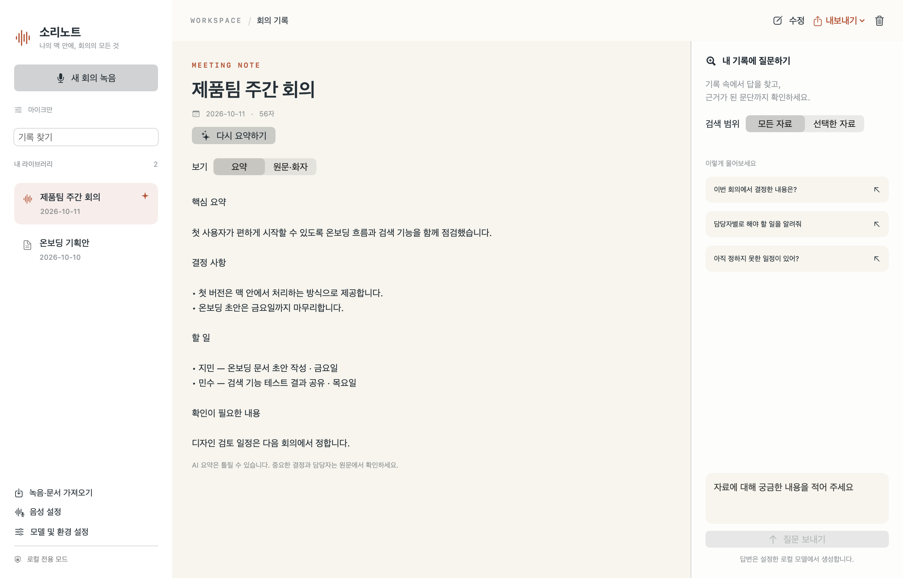
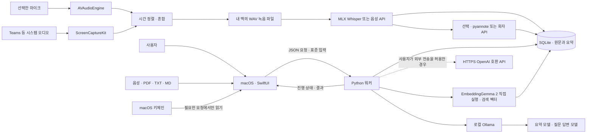

# 소리노트 · SoriNote

**회의를 녹음하고, 누가 말했는지 정리하고, 내 자료에서 답을 찾는 macOS 로컬 AI 앱입니다.**

SwiftUI로 만든 네이티브 화면과 Python 음성 처리 엔진을 연결했습니다. 회의 녹음, 전사문, 문서, 요약, 검색용 벡터는 내 맥에 저장합니다. 기본 설정에서는 로컬 모델만 사용하며, 외부 API는 사용자가 설정에서 전송을 허용한 경우에만 연결합니다.

Google AI Edge Foresight의 사용 흐름을 참고한 독립 프로젝트입니다. Google 공식 제품이나 Foresight의 소스 코드를 사용한 프로젝트는 아닙니다.



*앱의 실제 SwiftUI 화면을 예시 데이터로 렌더링한 모습입니다.*

> **현재 버전: 0.7.0, 녹음·전사 중 자동 구간 요약**
>
> Apple Silicon 맥과 macOS 14 이상을 대상으로 합니다. Python 엔진과 모델은 최초 한 번 설치해야 합니다. 화자 분리는 선택 기능이며 Community-1 이용 조건 동의와 Hugging Face 읽기 토큰이 필요할 수 있습니다. 마이크와 시스템 오디오를 따로 또는 함께 녹음할 수 있습니다. 녹음 중에는 설정한 구간이 끝난 뒤 전사·요약합니다. 단어 단위 실시간 자막과 스캔 PDF OCR은 포함하지 않습니다.

## 할 수 있는 일

| 기능 | 사용 방법 |
| --- | --- |
| 음성 녹음 | 마이크만 / 시스템 오디오만 / 둘 다 선택, 마이크 장치·입력별 음량 설정, 일시 정지와 복구를 지원합니다. |
| 음성 파일 가져오기 | WAV, M4A, MP3 등 FFmpeg가 읽을 수 있는 음성을 앱 안에 사본으로 보관합니다. |
| 문자 변환 | MLX Whisper 직접 실행 또는 OpenAI 호환 음성 API를 선택합니다. |
| 화자 분리 | pyannote 직접 실행 또는 화자 전사 API로 화자를 구분하고 이름을 수정합니다. |
| 원음 확인 | 전사문 시각을 누르면 해당 위치부터 녹음을 재생합니다. |
| 문서 가져오기 | 텍스트 PDF, UTF-8 TXT, Markdown을 읽습니다. PDF에는 쪽 번호를 붙입니다. |
| 자동 구간 요약 | 녹음·파일 전사 중 시간별 전사와 문맥 요약을 저장합니다. 간격 조정, 중지·이어하기, 선택형 전체 요약을 지원합니다. |
| 회의 요약 | 핵심 논의, 결정 사항, 담당자·기한이 있는 할 일, 확인할 내용을 정리합니다. |
| 자료 기반 질문 | 전체 자료 또는 선택한 자료에서 검색하고 답변과 근거 문단을 함께 보여 줍니다. |
| 편집과 내보내기 | 제목·본문과 화자 이름을 수정하고, 녹음·전사문 TXT·회의록 Markdown을 함께 또는 각각 저장합니다. |
| 모델과 인증 설정 | 음성 인식, 화자 분리, 요약, 질문 답변, 임베딩을 따로 설정합니다. Key는 키체인에 저장합니다. |

## 설치 파일로 빠르게 시작하기

`dist/SoriNote-0.7.0-arm64.pkg`를 열어 설치한 뒤, 응용 프로그램에서 **SoriNote → 준비 시작**을 누르세요. 설치된 ARM64 Python 3.12를 먼저 확인하고, 필요하면 전용 Python과 음성·검색 엔진을 준비합니다. 준비된 venv를 직접 연결하거나 기존 Python으로 새 전용 venv를 만들 수도 있습니다. 선택하면 현재 설정의 로컬 모델도 내려받습니다. 받는 맥에는 개발 도구, Homebrew, Python, Ollama를 미리 설치할 필요가 없습니다.

처음에는 인터넷과 25GB 이상의 여유 공간을 권장합니다. 기존 기록·모델·API 설정은 유지합니다. 화자 모델의 이용 조건 동의와 녹음 권한은 사용자가 직접 허용해야 합니다. 기존 사용자는 **모델 및 환경 설정 → 공통 환경 → 자동 설치 / 복구…**로 실행할 수 있습니다.

**현재 설치 파일은 개발용 빌드로, Developer ID 서명과 Apple 공증은 아직 적용하지 않았습니다.** 새 맥의 전체 설치 경험도 별도 확인이 필요합니다. [설치 안내서](docs/INSTALLATION.md)에 사용 순서, 저장 위치, 재시도, 배포용 서명 절차와 구조도를 정리했습니다.

소스에서 설치 파일을 만들려면 Command Line Tools가 있는 맥에서 다음을 실행합니다.

```bash
bash scripts/build-installer.sh
```

## 회사에서 Python 다운로드가 막힐 때

첫 실행 또는 **공통 환경 → 자동 설치 / 복구…**에서 실행 방식을 선택하세요.

| 상황 | 권장 선택 |
| --- | --- |
| 회사에 Python 3.12가 설치되어 있음 | **기존 Python으로 전용 venv 생성** → 해당 Python 실행 파일 선택. Python 다운로드는 건너뜁니다. |
| 이미 소리노트용 venv를 준비함 | **준비된 venv 연결** → `venv/bin/python` 선택. 기본값은 검사·연결만 합니다. |
| venv는 만들었지만 AI 패키지는 없음 | 별도 전용 venv를 만들거나, 해당 환경을 변경해도 된다면 **선택한 venv에 필수 패키지 설치**를 켭니다. |
| 회사 프록시나 인증서가 필요함 | **회사 네트워크 · 인증서 · 오프라인 설치**를 펼쳐 macOS 인증서, PEM 묶음, 프록시, Python 미러, 패키지 저장소를 지정합니다. |
| 다운로드 없이 준비하고 싶음 | 기존 Python/venv와 오프라인 패키지 폴더·모델 캐시를 준비한 뒤 **오프라인 준비**를 켭니다. 설치 파일 하나만으로 완전 오프라인 설치되지는 않습니다. |

`venv`는 설치된 Python을 분리해서 쓰는 환경입니다. venv를 만들거나 활성화하는 것만으로 Python 버전이 올라가지는 않습니다. 이 버전의 로컬 엔진은 **ARM64 Python 3.12**를 사용합니다. 다른 버전이면 호환되는 Python을 선택해야 합니다.

모델 준비가 실패하면 완료된 venv는 유지됩니다. 네트워크·인증 설정을 고친 뒤 **모델 준비 다시 시도**를 누르거나 **사용 시작** 후 각 단계에서 준비하세요. 오류 화면의 **진단 내용 복사**는 설치 단계와 민감 정보를 가린 오류 내용을 복사합니다.

소스 개발 환경은 다음처럼 기존 Python으로 venv 구성과 앱 실행을 이어서 할 수 있습니다. 경로는 회사에서 설치한 Python에 맞게 바꾸세요.

```bash
bash scripts/setup.sh --python /opt/homebrew/bin/python3.12 --launch
```

기존 앱의 `UV_*`·`PIP_*` 일괄 제거와 공개 PyPI 고정 동작을 수정했습니다. 지원 범위, 회사 인증서 설정 예시와 오프라인 파일 준비 절차는 [회사 환경 설치 안내](docs/INSTALLATION.md#회사-네트워크에서-설치하기)에 있습니다. 회사의 네트워크 차단이나 실행 통제를 앱이 우회하지는 않습니다.

## 소스에서 빌드하기

### 1. 개발 도구와 Ollama 준비

터미널에서 프로젝트 폴더로 이동하세요. 아래 명령은 이 README가 있는 프로젝트 루트 폴더에서 실행합니다.

```bash
# Command Line Tools가 없는 맥에서만 실행합니다.
xcode-select --install
```

[Ollama 공식 설치 페이지](https://ollama.com/download/mac)에서 macOS용 Ollama를 설치하고 실행합니다. 터미널에서 서버를 실행하려면 아래 명령을 별도 창에 입력하세요. 앱으로 이미 실행 중이라면 중복 실행하지 않아도 됩니다.

```bash
# Ollama 자체의 클라우드 기능도 끈 상태로 로컬 서버를 실행합니다.
OLLAMA_NO_CLOUD=1 ollama serve
```

다른 터미널에서 기본 텍스트 모델을 받습니다. 최초 다운로드에는 인터넷과 수 GB의 여유 공간이 필요합니다.

```bash
ollama pull gemma4:e4b
```

Gemma 4를 지원하는 최신 Ollama가 필요합니다. 이미 사용하는 로컬 모델이 있다면 모델을 추가로 받는 대신 앱 설정에서 그 이름으로 바꿔도 됩니다. 모델 설치 시 각 모델의 이용 조건도 확인해 주세요.

### 2. 음성 엔진 설치와 앱 빌드

```bash
bash scripts/setup.sh
bash scripts/build-app.sh
open dist/SoriNote.app
```

설치 스크립트는 프로젝트 안의 `.tools/`와 `.venv/`에 Python 3.12와 의존성을 준비합니다. 시스템 Python 패키지를 수정하지 않습니다. 실제로 설치한 버전은 `worker/requirements.lock.txt`로 고정합니다. 앱 빌드에는 Swift Package Manager를 사용하므로 별도 Xcode 프로젝트를 만들 필요가 없습니다.

빌드 결과는 `dist/SoriNote.app`입니다. Finder에서 더블 클릭해 실행할 수 있습니다. 현재 패키지는 로컬 임시 서명만 적용하며, 다른 사용자에게 배포할 Developer ID 서명·공증은 별도 작업입니다.

**위 방식은 개발용 빌드입니다.** `.app`을 옮겨도 기존 프로젝트의 `.venv`는 필요합니다. 프로젝트 경로를 바꾼 경우 `setup.sh`와 `build-app.sh`를 다시 실행하고 Python 경로를 수정하세요. 다른 맥에 설치할 파일은 `build-installer.sh`로 만듭니다. 설치 패키지 버전은 개발 맥의 `.venv` 경로를 포함하지 않고, 받는 맥에서 전용 환경을 새로 준비합니다.

### 3. 앱에서 모델 준비

1. 왼쪽 아래 **모델 및 환경 설정**을 엽니다. 앱 안의 설정창에서 바로 수정할 수 있습니다.
2. **공통 환경**에서 Python 경로가 이 프로젝트의 `.venv/bin/python`인지 확인합니다.
3. **음성 인식 → 모델 다운로드 / 준비**로 Whisper 가중치를 받습니다.
4. **검색용 임베딩 → 모델 다운로드 / 준비**로 EmbeddingGemma 2를 받습니다. 기본값은 맥에서 직접 실행입니다.
5. 화자 분리를 쓰려면 **화자 분리**에서 기능을 켭니다. Community-1 이용 조건에 동의한 계정의 읽기 토큰을 공통 환경에 넣고, 화자 단계의 모델을 준비합니다.
6. 단계별 변경 후 **설정 저장**을 누릅니다. 선택한 값은 다음 작업과 앱 재실행의 기본값이 됩니다.

준비 버튼은 현재 설정을 저장한 뒤 해당 단계의 모델만 다운로드합니다. 평소 전사와 검색은 캐시만 사용합니다. 개발용 빌드에서 요약과 질문 답변을 쓰려면 로컬 Ollama를 직접 실행하세요. 설치 패키지 버전은 기본 주소에 Ollama가 없을 때 내장 도구를 자동 실행합니다.

### 4. 첫 회의 기록

**새 회의 녹음 → 녹음 완료 → 문자 변환 → AI 요약 만들기** 순서로 사용합니다. 오른쪽 질문 패널에서는 “담당자별로 해야 할 일을 알려줘”처럼 질문할 수 있습니다.

UI를 먼저 둘러보려면 **예시 기록으로 둘러보기**를 누르세요. 이 버튼은 예시 문서를 실제 라이브러리에 추가합니다. 요약과 검색까지 시험하려면 해당 모델이 실행 중이어야 합니다.

## 녹음·전사 중 구간별로 자동 요약하기

**모델 및 환경 설정 → 회의 요약 → 자동 구간 요약**을 켜고 간격을 설정한 뒤 저장하세요. 처음에는 꺼져 있으며 기본 간격은 5분입니다. 로컬 전사는 1~30분, 음성 API는 파일당 25MB 제한에 맞춰 1~13분을 선택할 수 있습니다. 새 녹음과 기존 녹음의 **문자 변환**에 적용됩니다.

앞선 논의의 누적 맥락과 직전 발언을 참고해 해당 구간을 요약하고 **구간 요약** 탭에 시간별로 표시합니다. 간격은 녹음 길이 기준이며 결과에는 처리 시간이 더해집니다. 녹음은 계속하면서 **전사 → 요약을 차례로 실행**해 모델 동시 실행을 피합니다. 질문 답변·임베딩을 꺼도 사용할 수 있고 기존 회의 요약 모델·서버·API Key를 그대로 사용합니다.

녹음 중 **자동 요약 중지**를 눌러도 원음은 계속 저장합니다. 녹음 완료 후 **구간 처리 이어하기**로 남은 작업을 처리할 수 있습니다. 마지막 짧은 구간도 저장하며, **종료 후 전체 요약 만들기**는 별도로 선택합니다. 화자 분리를 켰다면 전체 전사 후 한 번 실행합니다. 구간 요약은 Markdown 내보내기에도 포함됩니다.


[구간 요약 안내서](docs/INTERVAL_SUMMARY.md)에 사용 순서, 메모리·시간의 관계, 복구 방식, 구조도와 개발 절차를 정리했습니다.

## 녹음과 전사문을 별도 파일로 보관하기

기록을 선택하고 위쪽 **내보내기 → 녹음 + 전사문 함께 저장…**에서 저장할 폴더를 고르세요. 선택한 위치에 회의 제목의 새 폴더가 만들어집니다.

```text
제품팀 주간 회의/
├── 녹음.wav      # 앱에 보관된 녹음의 사본. 가져온 파일은 원래 확장자 유지
├── 전사문.txt    # 제목, 작성 시각, 현재 원문. 원문에 있는 시간·화자 표시 유지
└── 회의록.md     # 제목, 작성 시각, AI 요약, 현재 원문
```

녹음만 또는 전사문만 따로 저장할 수도 있습니다. **함께 저장은 문자 변환이 끝난 뒤** 사용할 수 있으며, 요약은 없어도 됩니다. 같은 제목의 폴더가 있으면 `(2)`, `(3)`을 붙여 새 폴더를 만듭니다. 녹음을 재인코딩하거나 모델을 다시 실행하지 않으며, 앱에서 기록을 삭제해도 내보낸 파일은 남습니다. 자세한 내용은 [사용자 안내서](docs/USER_GUIDE.md#내보내기-백업-삭제)를 참고하세요.

## Teams와 시스템 오디오 녹음

왼쪽 **음성 설정**에서 **마이크 + 시스템 오디오**를 선택하고 저장하면 내 목소리와 상대방 소리를 함께 녹음합니다. 마이크 장치와 입력별 녹음 음량도 선택할 수 있습니다.

시스템 소리는 스피커를 마이크로 다시 듣는 대신 ScreenCaptureKit에서 직접 받습니다. 맥 출력 음소거와 별도로 수집하도록 구현했으며, 화면 영상은 저장하지 않습니다. Teams 자체가 음성 수신·재생을 멈춘 경우에는 원음이 없어 기록할 수 없습니다. 첫 사용에는 macOS의 **마이크**, **화면 및 시스템 오디오 녹음** 권한이 필요합니다.

실제 Teams 통화·출력 음소거 조합은 아직 실기 검증하지 않았습니다. [음성 설정 안내](docs/AUDIO.md)의 짧은 확인 절차와 권한 설명을 참고하세요.

## 기본 모델과 이 맥에서의 선택

개발 환경에서 확인한 하드웨어는 **Apple M5 Max, 통합 메모리 36GB**입니다. 아래 조합을 로컬 처리의 출발점으로 선택했습니다. 실제 회의 길이별 처리 시간과 한국어 정확도를 보장하는 벤치마크 수치는 아닙니다.

| 목적 | 기본 모델·엔진 | 선택한 이유 |
| --- | --- | --- |
| 음성 인식 | `mlx-community/whisper-large-v3-turbo` / MLX | Apple Silicon에서 다국어 음성을 처리하고 시간 정보를 얻습니다. |
| 화자 분리 | `pyannote/speaker-diarization-community-1` / CPU | 로컬 파이프라인과 단어 시각 정렬에 쓸 수 있는 배타적 화자 구간을 제공합니다. |
| 요약 | `gemma4:e4b` / Ollama | 맥에서 사용할 수 있는 Gemma 4의 비교적 작은 모델로 시작합니다. |
| 질문 답변 | `gemma4:e4b` / Ollama | 요약 모델과 별도로 설정할 수 있습니다. |
| 검색용 임베딩 | `google/embeddinggemma-2` / Sentence Transformers | 텍스트 부분만 로드해 Apple GPU에서 검색 벡터를 직접 생성합니다. |

다섯 단계의 실행 방식·모델을 각각 선택하고 저장할 수 있습니다. 모든 단계에서 **OpenAI 호환 API**를 선택하면 서버 주소와 API Key도 수정할 수 있습니다. 음성·화자 API는 해당 규격을 제공하는 서버가 필요합니다. 자세한 조건과 화면은 [모델 설정 안내](docs/MODELS.md)에 있습니다.

검색용 임베딩만 새 기본값을 사용하고 나머지 모델은 이전 버전 그대로입니다. 임베딩 설정을 바꾸면 다음 검색에서 대상 자료의 색인을 자동으로 다시 생성합니다. 이전 사용자 지정 모델·서버는 자동 이전 과정에서도 보존합니다.

화자 분리는 목소리를 구분하는 기능입니다. 이름을 알아내거나 서로 겹친 음성을 깨끗한 두 음원으로 분리하는 기능은 아닙니다. “화자 1”, “화자 2”는 해당 회의 안에서만 유효하며, 녹음마다 같은 사람이 같은 번호를 받는다는 보장은 없습니다.

## 모델별 필요 메모리와 맥 전체 권장 메모리

**기본 모델 조합을 로컬에서 사용하려면 통합 메모리 32GB 이상을 권장합니다.** 24GB는 다른 큰 작업을 줄이고 모델을 순서대로 실행하는 환경의 실용적인 출발점입니다. 현재 개발에 사용한 **36GB 맥은 권장 범위**에 들어갑니다. 다만 이 앱으로 장시간 회의의 최대 메모리를 측정한 결과는 아니며, 회의 길이와 함께 실행하는 앱에 따라 달라집니다.

### 메모리가 부족하면 기능을 선택해서 사용하세요

**모델 및 환경 설정 → 공통 환경 → 메모리에 맞춰 기능 선택**에서 **화자 분리 사용**, **질문 답변 사용 · 검색용 임베딩 포함**을 각각 켜거나 끄고 **설정 저장**을 누르세요. 각 단계의 설정 화면에서도 같은 값을 바꿀 수 있습니다.

| 선택 | 다음 작업에서 달라지는 점 |
| --- | --- |
| 화자 분리 끔 | 음성 인식은 계속 실행하고 화자 모델을 불러오지 않습니다. 새 전사문의 화자는 미지정으로 표시됩니다. |
| 질문 답변 끔 | 질문 입력을 비활성화하고 질문 답변·검색용 임베딩 모델을 불러오지 않습니다. 새 검색 색인도 만들지 않습니다. |
| 둘 다 끔 | 녹음·문자 변환·요약·내보내기를 계속 사용하면서 두 선택 기능의 모델 처리를 생략합니다. |

꺼진 기능은 자동 모델 준비와 연결 확인에서도 제외합니다. 이전에 받은 모델 파일과 기존 기록·화자 이름·요약·검색 색인은 지우지 않으므로 다시 켜서 이어 쓸 수 있습니다. 기능을 끄는 것과 전사문을 다시 생성하는 것은 별개의 작업입니다.

질문 답변과 요약은 기본적으로 **같은 Gemma 4 모델**을 번갈아 씁니다. 따라서 질문 답변을 끄더라도 요약을 실행하면 Gemma의 **약 8~12GB**는 여전히 필요합니다. 화자 분리 **약 4~8GB**, 임베딩 **약 3~5GB**의 처리 단계는 생략되지만, 이 값을 합친 만큼 맥 전체의 최대 메모리가 줄어든다고 보장하지는 않습니다. 원래도 모델을 순서대로 사용하기 때문입니다. 요약 단계에서도 부족하다면 더 작은 호환 요약 모델이나 다른 컴퓨터의 모델 서버를 선택하세요.

출고 기본값은 **화자 분리 꺼짐 / 질문 답변 켜짐**이며, 기존 설정을 읽을 때도 사용자가 저장한 값을 유지합니다. 처리 중에는 선택을 바꿀 수 없으며 저장 후 다음 작업부터 적용됩니다. Python 공용 패키지는 설치된 상태로 유지하고, 메모리를 크게 쓰는 모델 가중치의 로딩과 실행을 생략하는 방식입니다.

### 모델별로 확보할 메모리

아래 표는 **2026년 10월 11일의 앱 코드와 설치된 모델을 기준으로 잡은 실행 메모리 예산**입니다. 실제 최대 사용량을 측정한 벤치마크나 제작사가 보증한 최소 사양이 아닙니다. 모델 가중치뿐 아니라 실행 엔진과 중간 계산에 필요한 여유를 포함하되, macOS·Teams·브라우저의 메모리는 제외했습니다. Apple Silicon은 CPU와 GPU가 통합 메모리를 공유하므로 별도의 RAM과 VRAM으로 나눠 더하지 않습니다. 단위는 대략적인 GB이며 파일 크기와 메모리 사용량은 다릅니다.

설정에서 모델 이름을 자유롭게 입력할 수 있어 모든 모델의 필요 메모리를 한 표에 고정할 수는 없습니다. 여기서는 **현재 출고 기본값과 임베딩의 기본 대체 항목**을 다룹니다.

| 단계 | 모델과 실행 조건 | 실행 시 확보할 메모리 예산 · 추정 | 산정 근거와 주의점 |
| --- | --- | --- | --- |
| 음성 인식 | `mlx-community/whisper-large-v3-turbo` · MLX, FP16 가중치 | **약 4~6GB** | 설치된 가중치 파일은 약 1.61GB. 여기에 음성 파형, 변환 중간값, 시간 정렬 작업이 더해집니다. 긴 녹음에서는 범위를 넘을 수 있습니다. |
| 화자 분리 · 선택 기능 | `pyannote/speaker-diarization-community-1` · PyTorch CPU | **우선 약 4~8GB를 계획용으로 확보** | 실제 모델을 실행해 측정하지 못한 임시 예산입니다. 필요한 최소 메모리는 미확인입니다. 회의 길이·발화 구간 수에 따라 다시 측정해야 하며, 기능을 끄면 이 모델은 로드하지 않습니다. |
| 자동 구간 요약 | 녹음·파일 전사 중 시간별 전사와 문맥 요약을 저장합니다. 간격 조정, 중지·이어하기, 선택형 전체 요약을 지원합니다. |
| 회의 요약 | `gemma4:e4b` · Ollama, 설치된 GGUF Q4_K_M, 문맥 16,384토큰 | **약 8~12GB** | 설치된 패키지 전체는 약 6.58GB이고 주 모델 가중치는 약 5.49GB. 실행 시에는 문맥 캐시와 계산 버퍼가 추가됩니다. |
| 질문 답변 | `gemma4:e4b` · 위와 같은 조건 | **약 8~12GB** | 요약과 같은 모델을 순서대로 쓰므로 기본 구성에서 두 행을 합쳐 16~24GB로 계산하지 않습니다. 서로 다른 모델을 서버에 상주시킨다면 별도 계산이 필요합니다. |
| 검색용 임베딩 · 기본 | `google/embeddinggemma-2` · 텍스트 전용, float32, 배치 8, MPS 우선 | **약 3~5GB** | 텍스트 모델 약 2.7억 개 파라미터 × 4바이트 ≈ 가중치 1.08GB. PyTorch와 배치 계산 여유를 더했습니다. 전체 모델 파일 약 1.49GB는 내려받는 크기이며 텍스트 전용 실행 메모리와 다릅니다. |
| 검색용 임베딩 · 대체 | `embeddinggemma:300m` · Ollama, BF16 | **약 1~2GB** | 설치된 가중치 약 0.62GB에 실행 버퍼를 더한 예산입니다. EmbeddingGemma 2와 다른 모델이며 기본 선택은 아닙니다. |
| 어느 단계든 API로 변경 | 사용자가 지정한 OpenAI 호환 모델 | **모델 서버의 사양에 따라 결정** | 다른 컴퓨터의 서버라면 해당 가중치는 이 맥에 올라오지 않습니다. 같은 맥에서 서버를 실행하면 모델 메모리는 그대로 필요합니다. |

크기 확인에는 [MLX 모델 파일 목록](https://huggingface.co/mlx-community/whisper-large-v3-turbo/tree/main), [Gemma 4 E4B 배포 정보](https://ollama.com/library/gemma4:e4b), [EmbeddingGemma 2 모델 카드](https://huggingface.co/google/embeddinggemma-2), [EmbeddingGemma 300M 배포 정보](https://ollama.com/library/embeddinggemma:300m)와 설치된 파일의 메타데이터를 사용했습니다. **공식 자료가 위 실행 메모리 예산 전체를 보증하는 것은 아닙니다.** 특히 `gemma4:e4b`처럼 같은 태그여도 배포 시점·실행 백엔드·양자화 방식에 따라 파일과 메모리가 달라질 수 있습니다. 다른 패키지를 설치했다면 다시 확인하세요.

[Whisper 공식 안내](https://github.com/openai/whisper#available-models-and-languages)의 turbo VRAM 약 6GB는 참고값이며, 이 앱의 MLX 실행을 직접 측정한 수치가 아닙니다. [Community-1 모델 카드](https://huggingface.co/pyannote/speaker-diarization-community-1)는 CPU 실행과 메모리에 올린 파형 입력을 안내하지만 이 맥의 필요 RAM을 보증하지 않습니다. 화자 분리 실기 검증 여부는 [검증 기록](docs/VERIFICATION.md#화자-분리-검증-범위)에 따로 적었습니다.

### 맥 전체 메모리는 어떻게 잡나요?

| 맥의 통합 메모리 | 권장 사용 범위 |
| --- | --- |
| 8GB | 녹음·문서 관리 또는 다른 컴퓨터의 모델 서버 이용 중심. 기본 로컬 AI 조합은 권장하지 않습니다. |
| 16GB | 작은 모델이나 외부 모델 서버를 조합하는 제한적인 구성. 기본 로컬 조합에서는 스왑과 메모리 부족 가능성을 고려해야 합니다. |
| 24GB | 기본 모델을 한 번에 하나씩 실행하고 다른 무거운 앱을 줄이는 사용의 출발점. 긴 녹음과 화자 분리는 별도 확인이 필요합니다. |
| **32GB 이상** | **기본 권장.** 기본 모델에 macOS·Teams·브라우저가 쓸 여유를 두는 구성입니다. |
| **36GB · 현재 개발 맥** | 위 권장 범위에 해당합니다. 기본 전사·요약·검색 연결은 확인했지만 장시간 최대 메모리와 실제 화자 모델은 아직 검증하지 않았습니다. |
| 48~64GB 이상 | 더 큰 사용자 지정 모델, 여러 모델의 동시 상주, 많은 업무 앱을 함께 쓸 때 검토할 범위입니다. 모델별로 다시 산정해야 합니다. |

기본 구성은 대략 **가장 무거운 실행 단계 8~12GB + macOS·Teams·브라우저용 8~12GB + 여유 4~8GB = 약 20~32GB의 계획 예산**으로 생각하면 됩니다. 앞의 두 항목도 고정된 실측치가 아닌 운영 여유이며, 브라우저 탭이나 개발 도구가 많으면 더 필요합니다. 여유 있게 사용할 기준을 32GB 이상으로 잡은 이유입니다.

앱은 음성 인식 후 MLX 모델 캐시를 해제하고 화자 분리로 넘어갑니다. 검색에서는 직접 실행 임베딩을 해제한 뒤 답변 모델을 호출합니다. Ollama 요청에는 `keep_alive: 0`을 보내 응답 후 모델을 내리도록 요청합니다. 따라서 표의 모델 메모리를 모두 단순 합산하지 않습니다. 다만 엔진의 일시적인 캐시, 남아 있는 음성 파형, 다른 앱이 서버에 올린 모델까지 즉시 사라진다는 뜻은 아닙니다. Ollama의 모델 보관 동작은 [공식 FAQ](https://docs.ollama.com/faq#how-do-i-keep-a-model-loaded-in-memory-or-make-it-unload-immediately)를 참고하세요.

긴 회의는 추가 여유가 필요합니다. 현재 음성 처리 코드는 파일 전체를 16kHz 모노 float32 파형으로 읽습니다. **파형 한 벌만 약 0.23GB/시간, 4시간이면 약 0.92GB**이며, 디코딩 중 사본과 특징 계산 배열이 더 생깁니다. 녹음 파일이 약 115MB/시간인 것과 전사 시 메모리를 혼동하지 마세요. 긴 녹음·대규모 문서 색인·더 긴 모델 문맥을 사용하면 위 예산을 넘을 수 있습니다.

### 내 맥에서 확인하는 방법

1. **활성 상태 보기 → 메모리**에서 작업 전 상태를 확인합니다.
2. 실제로 사용할 길이의 시험 녹음으로 문자 변환, 화자 분리, 요약, 첫 검색을 각각 실행합니다. 화자 분리는 모델 준비가 끝난 경우에만 켭니다.
3. 소리노트뿐 아니라 Python, Ollama와 모델 실행 프로세스, Teams의 사용량 및 **메모리 압력·스왑 사용량의 증가**를 함께 봅니다. 프로세스별 수치의 단순 합계보다 맥 전체 상태를 기준으로 판단합니다.
4. 부족하면 다른 모델 앱을 종료하고 녹음을 나누거나, 더 작은 호환 모델 또는 다른 컴퓨터의 모델 서버로 해당 단계를 옮깁니다.

Ollama 모델의 설치 크기와 현재 로드 상태는 다음으로 확인할 수 있습니다. `ollama list`의 SIZE는 실행 메모리가 아니며, `ollama ps`는 모델이 로드된 동안에만 표시합니다. 소리노트는 처리 후 해제를 요청하므로 작업이 끝난 뒤 목록이 비어 있어도 정상입니다.

```bash
ollama list
ollama ps
```

## 모델을 추가하거나 바꾸는 절차

**같은 실행 방식에서 호환되는 모델을 추가하는 경우에는 앱 코드를 바꿀 필요가 없습니다.** 모델 파일을 준비하고 단계별 모델 이름을 저장하면 됩니다. 설정은 모델 목록을 계속 쌓는 방식이 아니라 **단계마다 사용할 모델 하나를 지정하는 방식**입니다. 모델 파일은 여러 개 설치해 두고 이름을 바꿔 선택할 수 있습니다.

### 1. 먼저 실행 방식과 호환성을 확인하세요

| 추가할 모델의 종류 | 앱에서 고를 실행 방식 | 준비할 것과 호환 조건 |
| --- | --- | --- |
| 다른 음성 인식 모델 | 음성 인식 → MLX | `mlx-whisper`가 읽을 수 있는 모델 저장소·폴더. 일반 PyTorch Whisper 파일이나 GGUF만으로는 실행되지 않습니다. 한국어에는 다국어 모델을 고르세요. |
| 다른 화자 분리 모델 | 화자 분리 → pyannote | pyannote 4에서 불러올 수 있고 `exclusive_speaker_diarization`을 반환하는 파이프라인. 형식이 다르면 어댑터 코드가 필요합니다. |
| 다른 요약·대화 모델 | 회의 요약 / 질문 답변 → Ollama | Ollama에 실제 설치된 로컬 대화 모델과 정확한 이름·태그. 한국어, system 메시지와 현재 요청 옵션을 지원해야 합니다. |
| 다른 직접 실행 임베딩 모델 | 검색용 임베딩 → Sentence Transformers | 설치된 Transformers·Sentence Transformers가 지원하는 모델. 현재 로더는 float32·`trust_remote_code=False`이며 별도 Python 코드 실행이 필요한 저장소는 바로 지원하지 않습니다. |
| 다른 Ollama 임베딩 모델 | 검색용 임베딩 → Ollama | `/api/embed`를 지원하는 임베딩 모델. 일반 대화 모델과 용도가 다릅니다. |
| 어느 단계든 모델 서버 사용 | 해당 단계 → OpenAI 호환 API | 해당 단계의 실제 API를 제공하는 서버, 모델 ID, 기본 주소, 필요한 API Key. 호환 API라는 이름만으로 모든 기능을 지원하는 것은 아닙니다. |

### 2. 모델을 준비하고 해당 단계에 저장하세요

**MLX·pyannote·Sentence Transformers로 직접 실행할 때**

1. **모델 및 환경 설정**에서 바꿀 단계를 선택하고 실행 방식을 고릅니다.
2. **모델 이름 또는 로컬 폴더**에 정확한 Hugging Face 저장소 ID 또는 모델 폴더의 절대 경로를 입력합니다. 단일 가중치 파일만이 아니라 해당 엔진이 요구하는 설정·토크나이저 등의 파일도 필요합니다.
3. 접근 제한 모델이면 모델 페이지에서 이용 조건에 동의하고 **공통 환경 → Hugging Face Token**에 읽기 토큰을 입력합니다.
4. **모델 다운로드 / 준비**를 누릅니다. 현재 설정을 먼저 저장하고 모델을 준비합니다. 이미 완성된 로컬 폴더를 지정했다면 그 폴더를 사용합니다.
5. 짧은 예시로 실제 문자 변환·화자 분리·검색을 실행합니다. 다운로드 성공은 엔진 호환성이나 정확도 검증을 대신하지 않습니다.

예를 들어 EmbeddingGemma 2 직접 실행은 **검색용 임베딩 → 맥에서 직접 실행 · Sentence Transformers → `google/embeddinggemma-2` → 모델 다운로드 / 준비** 순서입니다. 새로운 모델도 위 호환 조건을 만족하면 같은 순서로 추가합니다. 현재 앱의 **기본값 복원**은 선택한 단계를 출고값으로 돌리는 버튼이고, 내가 고른 모델을 새 사용 기본값으로 유지하려면 **설정 저장**을 누르면 됩니다.

**Ollama 모델을 추가할 때**

터미널에서 원하는 모델을 먼저 받습니다. 아래는 이미 지원하는 모델로 절차를 보여 주는 예시입니다.

```bash
# 요약·질문 답변용 모델 준비 예시
ollama pull gemma4:e4b

# 검색용 임베딩을 기존 300M 모델로 바꿀 때의 예시
ollama pull embeddinggemma:300m

# 설치된 정확한 이름과 태그 확인
ollama list
```

다른 모델을 추가할 때는 `pull` 뒤를 해당 모델의 실제 이름으로 바꿉니다. 앱에서는 해당 단계의 실행 방식을 **Ollama**, 서버 주소를 `http://127.0.0.1:11434`, 모델 이름을 `ollama list`에 표시된 값으로 입력하고 **저장하고 연결 확인**을 누르세요. 요약과 질문 답변은 별도 설정이므로 둘 다 바꾸려면 각 단계에서 지정해야 합니다. Ollama 방식의 모델 다운로드는 앱의 직접 실행 준비 버튼이 아니라 Ollama에서 진행합니다.

### 3. OpenAI 호환 API로 추가할 때

1. 모델 서버에서 원하는 모델을 설치·배포하고 실행합니다. 서버가 요구하는 모델 ID를 확인합니다.
2. 앱의 해당 단계에서 **OpenAI 호환 API**를 고릅니다. 처음 실행 방식을 바꾸면 모델 칸이 비므로 서버의 모델 ID를 직접 입력합니다.
3. **서버 기본 주소**에 예를 들어 `http://127.0.0.1:1234/v1`을 입력합니다. 이 주소는 형식 예시이며 서버를 자동으로 설치하거나 실행하는 기능은 아닙니다. `/chat/completions` 같은 기능별 경로까지 넣지 않습니다.
4. 인증이 필요한 서버면 해당 단계의 **API Key**에 키를 넣습니다. 인증이 없는 로컬 서버는 비워 둡니다. 단계마다 다른 서버와 키를 사용할 수 있으며 키는 macOS 키체인에 저장합니다.
5. 다른 컴퓨터나 외부 서비스에 연결한다면 **공통 환경 → 외부 서버로 음성·텍스트 전송 허용**을 켜고 HTTPS 주소를 사용합니다. 현재 로컬 전용 모드의 허용 범위는 이 맥의 루프백 주소입니다.
6. **저장하고 연결 확인** 후 해당 기능을 실제로 한 번 실행합니다. 연결 확인은 모델 목록 API 접근 수준의 점검이므로 음성·화자·임베딩 처리의 성공까지 보장하지 않습니다.

아래는 **이 앱이 요구하는 서버 계약**입니다. API Key를 넣는 것만으로 서버에 없는 기능이 생기지는 않습니다.

| 단계 | 기본 주소 뒤에 붙이는 경로 | 확인할 내용 |
| --- | --- | --- |
| 음성 인식 | `/audio/transcriptions` | `verbose_json`의 구간 시각·본문 또는 `json`의 본문. 앱의 업로드 제한은 파일당 25MB이며, 후속 화자 분리에는 구간 시각이 필요합니다. |
| 화자 분리 | `/audio/transcriptions` | `diarized_json`, `chunking_strategy=auto`, 화자와 시작·종료 시각이 있는 구간을 반환해야 합니다. |
| 회의 요약·질문 답변 | `/chat/completions` | 대화 메시지를 받아 `choices[0].message.content`에 완성된 답변을 반환해야 합니다. |
| 검색용 임베딩 | `/embeddings` | 각 입력에 대응하는 `data[].index/embedding`, 같은 차원의 유효한 벡터가 필요합니다. |

예를 들어 채팅 API만 제공하는 서버는 그대로 음성 인식이나 화자 분리 서버로 쓸 수 없습니다. 자세한 조건은 [모델·API 안내](docs/MODELS.md#모든-단계에서-openai-호환-api-사용하기)를 참고하세요.

### 4. 임베딩 모델을 바꿨다면 색인을 다시 만드세요

1. **검색용 임베딩**에서 새 모델과 실행 방식·주소·장치를 저장합니다. EmbeddingGemma 2를 다른 이름으로 서비스하는 경우 **검색 입력 형식 → EmbeddingGemma 형식**을 명시하고, 서버가 이미 접두어를 처리하면 **접두사 없음 · 서버에서 처리**를 고릅니다.
2. 기본적으로 다음 질문에서 **검색 대상 자료의 색인을 자동으로 다시 생성**합니다. 선택한 기록만 대상으로 질문했다면 다른 기록의 재생성은 그 기록을 검색할 때 이루어집니다.
3. **같은 모델 이름·주소를 유지한 채 서버의 가중치만 바꾼 경우**, 앱은 변경을 자동 감지하지 못합니다. **검색 색인 비우고 다음 검색에서 재생성**을 누르세요. 기존 색인을 비우지만 원문·전사문·요약은 유지합니다.
4. 새 모델로 전체 자료를 사용하려면 검색 범위를 **모든 자료**로 두고 질문합니다. 첫 검색은 자료를 다시 임베딩하므로 시간이 더 걸릴 수 있습니다.
5. 답을 아는 질문으로 근거 문단과 답변을 확인합니다. 검색이 나쁘면 모델의 한국어 지원과 요구하는 입력 접두어를 점검합니다. 현재 입력 형식 선택은 자동·EmbeddingGemma·접두사 없음이므로, 다른 모델만의 특수 형식은 서버 또는 코드에서 처리해야 합니다.

요약·질문 답변 모델만 바꾸는 경우에는 임베딩 색인을 비울 필요가 없습니다. 모델 설정을 바꿔도 이미 저장된 전사문이나 요약이 자동으로 다시 만들어지지는 않습니다. 필요하면 해당 작업을 다시 실행하고, 수동 수정한 전사문을 덮어쓰기 전에는 내보내 두세요.

### 5. 현재 엔진이 지원하지 않는 모델을 직접 실행하려면 · 개발자용

기존 엔진과 모델 파일·출력 형식이 맞지 않으면 모델 이름만 바꿔서는 동작하지 않습니다. 먼저 그 모델을 **기존 계약에 맞는 로컬 API 서버**로 실행할 수 있는지 확인하세요. 앱 안에 직접 실행 기능을 넣어야 한다면 다음 순서로 확장합니다.

1. **실행 어댑터 구현:** 음성·화자는 [audio.py](worker/sorinote/audio.py), 직접 실행 임베딩은 [local_embedding.py](worker/sorinote/local_embedding.py), 서버 호출은 [providers.py](worker/sorinote/providers.py)를 기준으로 추가합니다. 전사에는 본문·시각, 화자에는 시각별 화자, 임베딩에는 입력별 벡터, 대화에는 본문이라는 기존 반환 계약을 유지합니다.
2. **메뉴와 검증 등록:** 새 실행 방식이 필요하면 [Models.swift](Sources/SoriNote/Models.swift)의 `ModelStage.providers`, [SettingsView.swift](Sources/SoriNote/SettingsView.swift)의 표시·입력·초기값, [config.py](worker/sorinote/config.py)의 `PROVIDERS`와 검증을 함께 수정합니다. [intelligence.py](worker/sorinote/intelligence.py)의 공급자 선택이나 음성 분기도 연결합니다.
3. **준비·점검·취소 연결:** 다운로드는 준비 단계에서만 수행하고 추론은 로컬 캐시를 사용하도록 합니다. [worker/main.py](worker/main.py)의 점검 분기와 워커 오류 안내도 갱신합니다. 다른 단계로 넘어갈 때 모델 메모리를 해제하고 작업 취소가 가능한지 확인합니다.
4. **기본값과 설정 이전:** 출고값까지 바꾼다면 Swift의 `defaultProfile`·`ModelProfile`과 Python의 `DEFAULTS`를 맞춥니다. 기존 사용자가 저장한 모델·주소를 덮어쓰지 않도록 이전 규칙과 검사를 추가합니다. 단순히 내가 쓸 모델만 바꾸려는 경우에는 소스의 출고값을 수정할 필요가 없습니다.
5. **의존성과 검증:** 새 패키지는 [requirements.txt](worker/requirements.txt)에 명시하고 [requirements.lock.txt](worker/requirements.lock.txt)를 다시 생성합니다. 짧은 한국어 예시로 실제 모델의 출력·메모리·취소·실패 시 기존 자료 보존을 확인하고 자동 검사와 앱 빌드를 실행합니다. 기존 smoke 검사는 기본 모델의 이름·차원에 대한 가정이 있으므로 새 모델용 실제 실행 검사도 추가하세요.

```bash
# requirements.txt를 수정한 뒤 잠금 파일을 갱신하고 전용 환경에 설치합니다.
bash scripts/setup.sh --update-lock

# 자동 검사를 실행하고 변경한 Python 코드까지 앱 리소스에 다시 묶습니다.
bash scripts/test.sh
bash scripts/build-app.sh
```

이 과정에서 확인한 모델 ID·리비전, 가중치 형식, 실행 라이브러리 버전, 입력 길이, 최대 메모리와 검증하지 못한 조건을 문서에 남기세요. 순서도와 세부 계약은 [개발자 안내서](docs/DEVELOPER.md)에 있습니다.

## 전체 구조



자세한 순서도, 검색 원리, 실패 복구 방식은 [개발자 문서](docs/DEVELOPER.md)에 있습니다.

## 데이터와 네트워크

- 회의 데이터: `~/Library/Application Support/SoriNote/`
- 녹음 사본: 위 폴더의 `recordings/`, 아직 저장하지 못한 녹음: `drafts/`
- 원문·요약·벡터: `library.sqlite3`, 일반 설정: `settings.json`
- API Key와 Hugging Face Token: macOS 키체인의 `app.sorinote.local` 항목
- 직접 실행하는 음성·임베딩 모델: Hugging Face 기본 캐시 또는 설정한 로컬 모델 폴더
- Ollama 모델: Ollama가 관리하는 모델 저장소

기본 모드에서는 루프백 주소만 연결하고, 리디렉션·환경 프록시·알려진 Ollama 클라우드 모델을 차단합니다. 음성 라이브러리의 사용 통계 전송도 끕니다. 단, 사용자가 연결한 로컬 서버가 내부적으로 다른 서버에 요청을 중계하는지까지 보장하지는 못합니다. 외부 API 사용 시에는 설정에서 음성·텍스트 전송을 허용해야 합니다. 음성 인식·화자 분리를 API로 선택하면 녹음 파일도 전송 대상입니다.

SQLite와 녹음 파일 자체를 암호화하지는 않습니다. Mac 계정과 FileVault, 백업 정책을 함께 관리하세요. 녹음 전에는 참석자에게 녹음 사실을 알려 주세요. 자세한 보관·삭제 범위는 [보안 설명](SECURITY.md)을 참고하세요.

## 저장소 구성

```text
SoundNote/
├── Package.swift                 # macOS 앱 빌드 정의
├── Sources/SoriNote/             # 한국어 UI, 녹음, 키체인, 워커 연결
├── Tests/SoriNoteTests/          # Swift 모델·프로세스 통합 검사
├── Tests/AudioSmoke/            # 합성 오디오 혼합·WAV·복구 검사
├── Tests/ExportSmoke/           # 녹음·전사문 저장, 취소·오류 시 원본 보존 검사
├── Tests/InstallerSmoke/        # 설치·재설치·취소·이전 실행 환경 보존 검사
├── worker/
│   ├── main.py                  # JSON 요청 진입점
│   ├── sorinote/                # 저장, 모델 연결, 전사, 화자 분리, RAG
│   ├── tests/                   # 모델 다운로드 없는 자동 검사
│   ├── requirements.txt         # 지원 버전 범위
│   └── requirements.lock.txt    # 설치에 사용하는 고정 버전
├── scripts/                     # 설치·빌드·테스트
├── installer/                   # 설치 화면, 공식 도구 버전·해시·라이선스
├── docs/                        # 사용자·개발자·모델·검증 문서
├── assets/Info.plist            # 앱 정보와 마이크 권한 설명
└── .github/workflows/check.yml  # GitHub Actions
```

`.gitignore`는 가상 환경, 앱 빌드 결과, 녹음·영상, 모델 가중치, DB와 보조 파일, 개인 설정, 인증 정보를 제외합니다. `.runtime/`의 점검 결과와 개발 맥의 경로도 올리지 않습니다. 소스와 문서, `docs/assets/`의 예시 화면, `worker/requirements.lock.txt`는 포함합니다.


### 첫 업로드 순서

현재 준비된 프로젝트는 `main` 브랜치의 Git 저장소로 초기화되어 있으며 첫 커밋과 원격 저장소 등록은 아직 하지 않은 상태입니다. 아래는 직접 업로드할 때의 순서입니다. 다른 맥에서 복제했다면 해당 맥의 프로젝트 경로로 이동하고 이미 설정된 원격 주소를 사용하세요.

```bash
# 프로젝트를 둔 저장소 루트로 이동합니다. 실제 위치에 맞게 바꾸세요.
cd ~/study/SoundNote

bash scripts/test.sh

# .git이 없는 새 복사본에서만 초기화합니다. 이미 초기화했다면 건너뜁니다.
git init -b main

# 파일을 추가하기 전에 후보와 제외된 폴더를 확인합니다.
git status --short
git status --short --ignored

# 추가 후에는 변경 내용까지 확인합니다.
git add .
git diff --cached --stat
git diff --cached
git commit -m "feat: 소리노트 macOS 로컬 회의 도우미"

# GitHub에서 README·라이선스·gitignore를 생성하지 않은 빈 저장소를 만드세요.
# 아래 YOUR_ACCOUNT와 YOUR_REPOSITORY를 실제 값으로 바꿉니다.
git remote add origin https://github.com/YOUR_ACCOUNT/YOUR_REPOSITORY.git
git push -u origin main
```

이미 `origin`이 있으면 다시 추가하지 말고 `git remote -v`로 주소를 확인하세요. `.gitignore`에 등록된 파일을 `git add -f`로 강제로 추가하지 않는 것이 기본 사용 방식입니다. 파일이 왜 제외되는지는 `git check-ignore -v exports/전사문.txt`처럼 확인할 수 있습니다.

`.gitignore`는 **이미 Git이 추적하는 파일을 자동으로 빼지 않습니다.** 그런 파일이 있으면 `git rm --cached -- 파일경로`로 추적만 해제하고, 폴더는 `git rm -r --cached -- 폴더경로`를 사용합니다. 디스크의 원본은 남습니다. 이전 커밋이나 GitHub에 실제 API Key를 올렸다면 추적 해제만으로 과거 기록에서 없어지지 않으므로 해당 키를 폐기·재발급하고 공개 기록도 별도로 정리해야 합니다.

자동 검사는 모델 다운로드 없이 데이터 일관성과 개인정보 경계를 검증합니다. 실제 모델 품질·마이크·장시간 회의는 별도 실기 검증이 필요합니다. 현재 검증 범위는 [검증 기록](docs/VERIFICATION.md)에 구분해 적었습니다.

## 문서

- [자동 구간 요약: 사용법·구조·복구](docs/INTERVAL_SUMMARY.md)

- [음성 설정과 Teams 녹음](docs/AUDIO.md): 녹음 소스·마이크 장치·음소거·권한·확인 방법
- [사용자 안내서](docs/USER_GUIDE.md): 처음 실행하기, 회의 기록, 문서 검색, 오류 해결
- [개발자 안내서](docs/DEVELOPER.md): 구조도, 처리 원리, 프로토콜, DB와 확장 방법
- [모델 선택과 API 설정](docs/MODELS.md): 역할별 선택, 토큰, 메모리와 화자 분리 한계
- [검증 기록](docs/VERIFICATION.md): 실행한 검사와 아직 확인하지 못한 부분
- [기여 방법](CONTRIBUTING.md), [보안 설명](SECURITY.md)

## 참고 자료

- [Google AI Edge Foresight](https://developers.google.com/edge/foresight)
- [MLX Whisper 공식 예제](https://github.com/ml-explore/mlx-examples/tree/main/whisper)
- [Community-1 모델 카드](https://huggingface.co/pyannote/speaker-diarization-community-1)
- [Ollama Gemma 4](https://ollama.com/library/gemma4), [EmbeddingGemma](https://ollama.com/library/embeddinggemma)
- [EmbeddingGemma 2 공식 모델 카드](https://huggingface.co/google/embeddinggemma-2)
- [Ollama Chat API](https://docs.ollama.com/api/chat), [Embed API](https://docs.ollama.com/api/embed)

프로젝트 코드는 MIT 라이선스입니다. 각 모델의 가중치와 외부 라이브러리에는 각자의 라이선스가 적용됩니다.
- [자동 설치 안내서](docs/INSTALLATION.md): 설치 파일 사용, 재시도, 저장 위치, 구조도와 패키지 빌드
