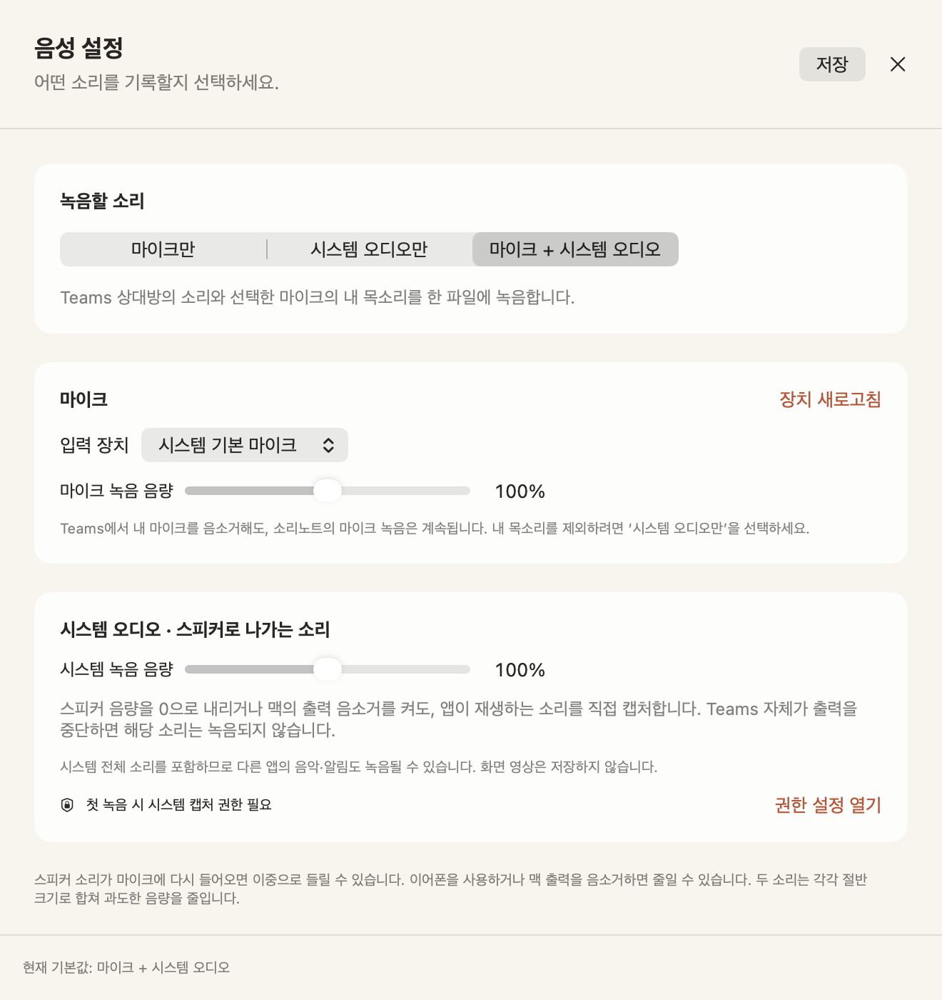

# 음성 설정과 Teams 회의 녹음

왼쪽 아래 **음성 설정**에서 녹음할 소리를 고르고 **저장**하세요. 다음 녹음부터 적용하며 앱을 다시 실행해도 유지합니다. 기존 사용자는 이전처럼 마이크만 사용하는 설정으로 시작합니다.

## 녹음 소스 고르기

| 선택 | 포함하는 소리 | 용도 |
| --- | --- | --- |
| 마이크만 | 선택한 마이크의 입력 | 대면 회의, 음성 메모 |
| 시스템 오디오만 | 맥의 앱들이 재생하는 소리 | Teams 상대방 소리만 기록 |
| 마이크 + 시스템 오디오 | 선택한 마이크와 맥의 앱 소리 | 내 발언과 Teams 상대방 소리를 함께 기록 |

시스템 오디오는 **전체 앱 소리**를 대상으로 합니다. Teams 한 앱만 고르는 필터는 아직 없으므로, 다른 앱에서 재생되는 음악이나 알림도 포함될 수 있습니다. 소리노트 자체의 재생 소리는 제외합니다. 화면 영상은 파일에 저장하지 않습니다.

마이크 목록에서 Mac 내장 마이크, USB 마이크 등 연결된 입력 장치를 고를 수 있습니다. **시스템 기본 마이크**는 녹음을 시작할 때 맥의 기본 입력 장치를 따릅니다. 새 장치를 연결했다면 **장치 새로고침**을 누르세요. 이전에 선택한 장치가 없으면 다른 마이크로 몰래 바꾸지 않고 다시 선택하도록 안내합니다.

녹음 중 장치가 바뀌면 입력 형식도 달라질 수 있어 녹음을 멈추고 임시 파일을 보관합니다. 녹음을 마친 뒤 장치를 변경하는 것이 좋습니다.

## 스피커가 무음이어도 기록하는 원리

마이크로 스피커에서 나오는 소리를 다시 듣는 방식이 아닙니다. macOS의 ScreenCaptureKit에서 시스템 오디오 데이터를 직접 받고, 별도로 선택한 마이크 입력과 합칩니다. 맥 출력 음량을 0으로 내리거나 출력 음소거를 사용하는 상황도 이 경로로 처리하도록 구현했습니다. [Apple의 ScreenCaptureKit 안내](https://developer.apple.com/documentation/screencapturekit/capturing-screen-content-in-macos)

무엇을 음소거했는지에 따라 결과가 다릅니다.

| 상황 | 녹음에 미치는 영향 |
| --- | --- |
| 맥의 스피커 출력 음량 0 또는 출력 음소거 | 시스템 오디오를 직접 캡처하므로 녹음을 유지하도록 설계 |
| 이어폰으로 듣기 | 시스템 오디오를 캡처하면서 마이크의 스피커 재수음을 줄일 수 있음 |
| Teams에서 **내 마이크** 음소거 | 상대방 소리는 계속 대상. 소리노트의 마이크 입력은 별개라 내 말도 녹음될 수 있음 |
| 상대방이 마이크를 끔 | 그 사람의 원음이 전달되지 않아 기록 불가 |
| Teams에서 소리 수신·재생 자체를 중단, 통화 종료 | 시스템에 원음이 없어 기록 불가 |
| 소리노트의 **녹음 음량**을 0%로 변경 | 해당 입력은 녹음 파일에 무음으로 들어감 |

이 기능의 합성 오디오 변환·혼합 검사는 통과했습니다. **실제 Teams 통화와 출력 음소거 조합은 아직 실기 검증하지 않았습니다.** 회의 앱, 출력 장치, macOS 권한에 따른 차이가 있을 수 있으므로 중요한 회의 전에 아래의 짧은 확인 절차를 진행하세요. DRM 등으로 보호된 오디오는 캡처되지 않을 수 있습니다.

## 처음 필요한 권한

마이크를 사용하는 모드에서는 **마이크** 권한을 요청합니다. 시스템 오디오만 선택했다면 마이크 권한은 요청하지 않습니다.

시스템 오디오를 사용하는 모드에서는 macOS의 **화면 및 시스템 오디오 녹음** 권한이 필요합니다. 운영체제 버전에 따라 메뉴 이름은 **화면 기록**으로 보일 수 있습니다. 권한 이름에 화면이 포함되어 있어도 이 앱은 오디오 출력만 구독하고 화면 프레임은 저장하지 않습니다.

1. 음성 설정에서 원하는 소스를 저장하고 새 회의 녹음을 시작합니다.
2. macOS가 권한을 물으면 소리노트를 허용합니다.
3. 허용 뒤 재실행이 필요하다고 나오면 앱을 종료하고 다시 엽니다.
4. 설정을 다시 찾으려면 음성 설정의 **권한 설정 열기**를 누릅니다.

이 앱은 로컬 임시 서명을 사용합니다. 재빌드 후 권한을 다시 허용해야 할 수 있습니다. 권한 거절 상태에서 시스템 오디오를 빼고 마이크만 녹음하는 식으로 자동 우회하지 않습니다. 선택한 소스를 시작하지 못하면 오류를 표시합니다.

## Teams에서 처음 확인하기

1. **마이크 + 시스템 오디오**를 선택하고 사용할 마이크를 고릅니다. 녹음 음량은 우선 각각 100%로 둡니다.
2. 회의 또는 테스트 통화에 들어가 상대방 소리가 재생되는지 확인합니다.
3. 소리노트에서 새 회의 녹음을 시작합니다. 위쪽 **마이크 / 시스템** 표시가 각각 움직이는지 확인합니다.
4. 처음 몇 초는 일반 음량으로 녹음하고, 이후 **맥의 출력 음량만** 0으로 내립니다. Teams의 통화 연결과 수신은 유지합니다.
5. 상대방 소리와 내 발언이 있는 상태로 약 10초 더 녹음한 뒤 완료합니다.
6. 맥 출력 음량을 다시 올리고 저장된 녹음을 재생합니다. 음소거 전후의 상대방 소리와 내 목소리를 확인합니다.

시스템 입력 표시가 움직이지 않으면 앱의 재생 상태와 권한을 먼저 확인하세요. 표시가 움직이는데 파일이 무음이면 소리노트의 녹음 음량이 0인지 확인합니다. 스피커 소리가 마이크로 다시 들어와 이중으로 들리면 이어폰 또는 맥 출력 음소거를 사용하세요. 별도 에코 제거 모델은 적용하지 않았습니다.

## 저장과 일시 정지

녹음은 **16kHz, 모노, 16비트 PCM WAV**로 저장합니다. 말소리 전사에 맞춘 형식이며 약 115MB/시간입니다. 두 소스를 각각 저장하는 대신 시간에 맞춰 하나의 파일로 합칩니다. 둘 다 사용하는 경우 각 소스를 절반 크기로 섞고, 범위를 넘는 신호는 제한합니다. 설정의 입력별 녹음 음량은 이 혼합 전에 적용합니다.

일시 정지하면 해당 시간의 샘플을 최종 파일에서 제외합니다. 입력 장치와 캡처 스트림은 재개를 위해 열린 상태로 남으므로 macOS의 사용 표시가 계속 보일 수 있습니다. 녹음 완료나 앱 종료 때 입력을 닫습니다.

파일은 조금씩 디스크에 기록하고 매초 WAV 헤더를 갱신합니다. 정상 완료 후 라이브러리에 등록합니다. 비정상 종료나 입력 오류로 `drafts/`에 남은 녹음은 다음 실행에서 헤더를 확인·복구한 뒤 라이브러리에 등록합니다. 손상된 파일은 삭제하지 않고 남겨 둡니다. 전원 차단으로 운영체제가 디스크에 기록하지 못한 부분까지 되살리는 기능은 아닙니다.

## 녹음 파일을 원하는 폴더에 보관하기

녹음을 완료한 뒤 **내보내기 → 녹음 파일만 저장…**을 누르면 별도 WAV 사본을 저장합니다. 전사까지 마쳤다면 **녹음 + 전사문 함께 저장…**에서 보관할 폴더를 선택하세요. 회의 제목의 새 폴더에 `녹음.wav`, `전사문.txt`, 요약 포함 `회의록.md`가 들어갑니다. 요약을 만들기 전에도 저장할 수 있습니다.

복사 과정에서는 녹음을 다시 압축하거나 변환하지 않습니다. 가져온 M4A·MP3 등의 파일은 원래 형식을 유지합니다. 마이크와 시스템 오디오를 함께 녹음한 파일은 혼합된 한 파일로 내보내며, 입력별 분리 저장은 지원하지 않습니다. 앱에서 기록을 삭제해도 내보낸 사본은 남습니다. [내보내기 안내](USER_GUIDE.md#내보내기-백업-삭제)에서 파일별 내용과 취소 동작을 확인할 수 있습니다.
