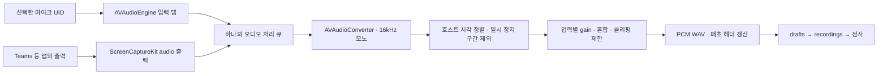
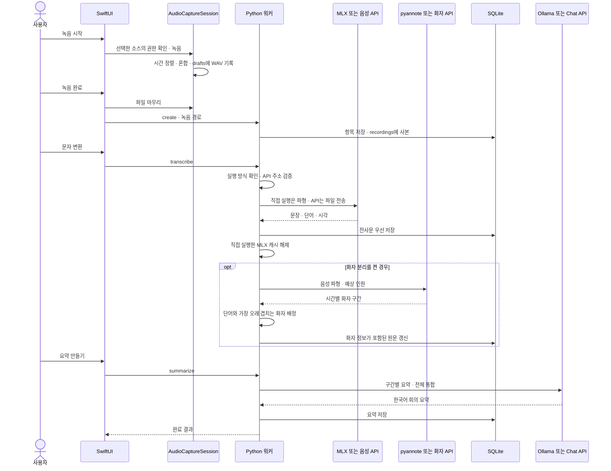
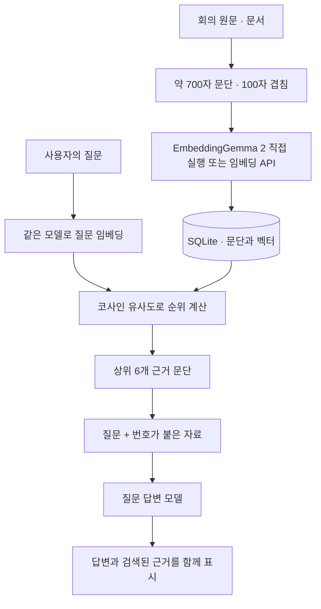
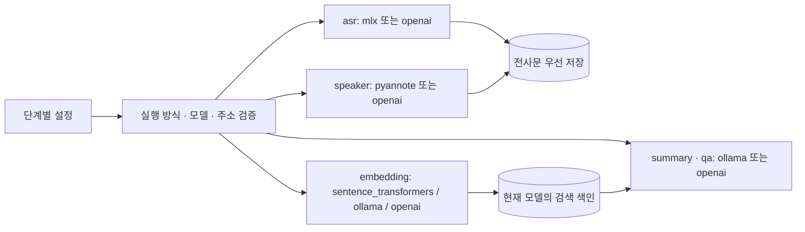
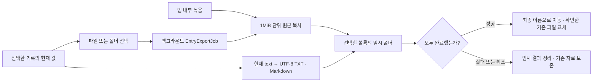

# 소리노트 개발자 안내서

## 설계의 출발점

사용자가 하고 싶은 일은 “녹음을 맡기고, 읽을 수 있는 회의록을 얻는 것”입니다. 따라서 화면은 기록과 질문에 집중하고, 모델 실행은 별도 Python 프로세스로 분리했습니다. 모델 라이브러리가 앱 프로세스와 충돌하거나 메모리를 오래 붙잡는 일을 줄이기 위한 구조입니다.

SwiftUI는 화면·파일 선택·마이크·재생·키체인을 담당합니다. Python은 데이터 저장·음성 변환·화자 정렬·요약·검색을 담당합니다. 두 계층은 JSON으로 대화합니다. Python용 HTTP 서버는 만들지 않았으므로 별도 백엔드 포트를 열 필요가 없습니다. 모델 설정이 Ollama 또는 OpenAI 호환 API일 때만 해당 서버의 HTTP API를 사용합니다. 직접 실행 임베딩에는 서버가 필요하지 않습니다.

## 구성 요소와 책임

| 파일 | 책임 |
| --- | --- |
| `SoriNoteApp.swift` | 앱 진입점, 메뉴, 작업 중 종료 확인 |
| `ContentView.swift` | 라이브러리, 원문·요약, 질문 패널, 편집 화면 |
| `SettingsView.swift` | 역할별 모델·서버·키 설정, 모델 준비, 점검 |
| `RuntimeSetupView.swift` / `RuntimeInstaller.swift` | 첫 실행 설치 화면, 전용 Python·패키지 설치, 잠금·취소·완료 후 환경 교체 |
| `installation.py` / `local_server.py` | 선택한 로컬 모델 준비, 내장 Ollama 실행과 소유 프로세스 정리 |
| `AppStore.swift` | UI 상태, 작업 직렬 실행, 파일 가져오기, 워커 호출 |
| `ExportMenuItems.swift` | 앱 상단과 macOS 파일 메뉴의 내보내기 항목·활성화 조건 공유 |
| `EntryExporter.swift` | 녹음·TXT·Markdown 내보내기, 안전한 이름, 취소와 임시 파일 정리 |
| `AudioController.swift` | 녹음 세션 생명주기, 입력별 레벨, AVAudioPlayer 재생 |
| `AudioSettingsView.swift` | 녹음 소스·마이크 UID·입력 음량 설정 |
| `AudioCapture.swift` | AVAudioEngine 마이크, ScreenCaptureKit 시스템 오디오, PCM 변환 |
| `CaptureTimeline.swift` | 공통 시각 정렬, 일시 정지 제거, WAV 저장과 복구 |
| `WorkerClient.swift` | Python 프로세스 시작, 파이프 통신, 진행 상태, 취소 |
| `Keychain.swift` | macOS 키체인의 인증 정보 읽기·갱신·삭제 |
| `Models.swift` | 화면과 워커가 공유하는 Codable 데이터 형태 |
| `ViewState.swift` | SDK 27의 동명 매크로와 기존 State 래퍼를 명확히 구분 |
| `worker/main.py` | 요청 검증·분배, 작업별 오류 처리, JSON 이벤트 출력 |
| `config.py` | 기본 모델, 설정 병합, 네트워크 주소 정책 |
| `store.py` | SQLite 원문·요약·검색 색인, 녹음 사본 관리 |
| `providers.py` | Ollama와 OpenAI 호환 API의 공통 인터페이스 |
| `audio.py` | MLX 또는 API 전사, pyannote 또는 API 화자 구간, 시각 검증과 정렬 |
| `local_embedding.py` | EmbeddingGemma 2 등 Sentence Transformers 모델의 오프라인 직접 실행 |
| `intelligence.py` | 문서 분할, 재귀 요약, 임베딩, 검색과 답변 생성 |

## 마이크·시스템 오디오 녹음 구조



마이크는 Core Audio의 영구 UID로 선택하며 AVAudioEngine의 입력 장치만 변경합니다. 맥 전체의 기본 장치나 스피커 음량은 바꾸지 않습니다. 시스템 오디오는 ScreenCaptureKit의 `capturesAudio=true`, `excludesCurrentProcessAudio=true`로 수집하고 `.audio` 출력만 등록합니다. 화면 출력 콜백은 등록하지 않습니다. 시스템 전체 앱의 소리를 대상으로 하며 앱별 필터는 현재 없습니다. 오디오 캡처와 출력 장치 음량을 연결하는 코드는 없습니다.

각 입력 버퍼의 형식은 `AVAudioConverter`로 16kHz 모노 float32에 맞춥니다. 마이크 콜백은 버퍼 사본을 큐로 넘기므로 엔진의 버퍼 재사용과 경쟁하지 않습니다. 호스트 시각은 마이크의 `AVAudioTime.hostTime`과 시스템 `CMSampleBuffer`의 presentation timestamp를 사용합니다. 10초 이상 어긋난 시각은 잘못 정렬한 파일을 만드는 대신 오류로 처리합니다.

`CaptureTimeline`은 같은 시각의 입력 샘플을 합치며 0.5초의 도착 지연을 흡수합니다. 이미 디스크에 쓴 시각으로 늦게 온 샘플은 중복 삽입하지 않고 지연 카운터에 기록합니다. 입력이 없는 구간은 무음으로 채워 두 소스의 시간축을 유지합니다. 일시 정지 구간은 최종 시간축에서 제거합니다. 입력 장치 자체는 일시 정지 중에도 열려 있지만 해당 구간은 저장하지 않습니다.

둘 다 녹음하면 각 소스에 0.5의 여유 계수를 적용합니다. 사용자 gain은 0~2이며 최종 샘플을 -1~1로 제한한 뒤 16비트 PCM으로 저장합니다. 에코 제거와 화자별 채널 분리는 구현하지 않았습니다. 파일은 16kHz 모노 WAV로 약 115MB/시간이며 최대 4시간입니다.

정상 종료는 입력 중단과 큐 정리를 기다려 마지막 버퍼까지 저장합니다. 앱 종료도 비동기 마무리를 기다립니다. PCM 헤더를 매초 갱신하고, 다음 실행에서 남은 WAV의 실제 파일 크기를 기준으로 헤더를 복구합니다. 포맷이 다른 파일은 수정하지 않습니다. 한 파일의 복구가 실패해도 다른 파일은 계속 복구합니다. 시스템이 디스크에 쓰지 못한 오디오를 복원하는 기능은 아닙니다.

`AudioCaptureSink`의 가변 상태는 전용 직렬 큐 안에서만 접근합니다. 이 조건을 전제로 `@unchecked Sendable`을 명시했으므로, 새로운 공개 메서드도 큐를 거치도록 유지해야 합니다. AVAudioEngine의 macOS 14 호환 API를 사용하므로 최신 SDK에서 대체 API 권고 경고가 나타날 수 있습니다.

녹음 설정은 `AppSettings.audio`에 들어갑니다. 기존 설정 파일에 이 항목이 없으면 `microphone`, 시스템 기본 마이크, 입력 음량 100%로 채웁니다. 모델 설정과 녹음 설정은 별도 화면에서 같은 설정 파일의 해당 부분만 바꿉니다.

Apple 참고: [ScreenCaptureKit 캡처 구성과 출력](https://developer.apple.com/documentation/screencapturekit/capturing-screen-content-in-macos), [시스템 오디오 권한 설명](https://developer.apple.com/documentation/bundleresources/information-property-list/nsaudiocaptureusagedescription).

## 회의 처리 순서



### 음성 인식 원리

입력 파일을 FFmpeg로 읽어 샘플레이트 16,000Hz, 모노, float32 파형으로 맞춥니다. 이후 MLX Whisper에 전달해 언어 인식과 텍스트 생성을 수행합니다. 단어 시각도 요청하므로 사용자가 특정 발언으로 돌아갈 수 있고, 화자 분리 결과와도 결합할 수 있습니다.

화자 분리는 별도의 문제입니다. Whisper의 문장 시각만으로 사람이 누구인지 알 수 없기 때문에, pyannote 파이프라인을 따로 실행합니다. MLX의 전역 모델 캐시를 비운 뒤 CPU 화자 분리로 넘어가 메모리 피크를 줄입니다. 이 동작은 mlx-whisper 0.4.x의 `ModelHolder` 구조를 사용하므로 버전을 올릴 때 다시 확인해야 합니다.

### 화자 분리와 정렬 원리

화자 분리는 음성에서 말하는 구간을 찾고, 목소리 특징을 비교해 같은 사람의 구간을 묶는 작업입니다. Community-1의 배타적 화자 구간은 한 시점에 한 화자만 배정하므로 단어 시각과 연결하기 쉽습니다.

단어 `w=[start,end]`와 화자 구간 `t=[a,b]`가 겹치는 시간은 아래와 같습니다.

```text
겹친 시간 = max(0, min(end, b) - max(start, a))
```

같은 화자의 구간이 여러 개라면 겹침을 합산합니다. 가장 많이 겹친 화자를 단어에 붙이고, 겹치는 구간이 없으면 `미확인`으로 남깁니다. 같은 화자의 인접 단어는 최대 약 25초 범위의 발언 단위로 합칩니다. 단어 시각이 없는 경우에는 문장 단위로 같은 계산을 합니다.

이는 화자의 실제 이름을 추론하는 생체 식별 기능이 아닙니다. 이름은 사용자가 붙입니다. 겹치는 음성을 별도 음원으로 분리하거나, 다른 회의에 같은 사람을 자동 연결하지 않습니다.

## 검색 증강 생성(RAG)의 원리

“임베딩”은 문장을 의미를 비교할 수 있는 숫자 배열로 바꾸는 과정입니다. 질문과 문단을 같은 모델로 변환하고, 방향이 가까운 벡터를 찾아 관련 자료를 고릅니다.



검색 벡터는 SQLite에 JSON 배열로 저장하며 Python에서 직접 코사인 유사도를 계산합니다. 작은 개인 라이브러리에서 구조를 이해하고 수정하기 쉬운 선택입니다. 자료가 많아지면 매 질문마다 벡터를 읽는 비용이 커지므로 `sqlite-vec`나 별도 벡터 색인으로 교체할 수 있습니다. 현재 벡터 검색은 근사 검색이 아닌 전체 비교입니다.

EmbeddingGemma를 쓰는 경우 질문에는 `task: search result | query:`, 문서에는 `title: … | text:` 형태를 적용합니다. 다른 모델은 이 접두어가 맞지 않을 수 있으므로 자동 설정에서는 원문만 전달합니다. 서버 별칭에는 promptStyle=embeddinggemma를, 서버가 접두어를 처리한다면 plain을 선택할 수 있습니다.

색인의 식별값에는 임베딩 프로필 전체(실행 방식·서버·모델·입력 형식·장치), 제목, 원문, 문단 분할 버전을 포함합니다. 하나라도 바뀌면 다시 임베딩합니다. 같은 모델 이름을 유지한 채 서버 쪽 가중치만 바꾼 경우에는 자동 감지하지 못하므로 사용자가 색인을 초기화해야 합니다.

벡터 개수·차원·유한한 숫자·영벡터 여부를 확인합니다. 새 벡터를 모두 받은 다음 한 트랜잭션으로 교체해, 생성 실패로 기존 색인이 중간 상태에 빠지지 않게 합니다. 답변의 출처 목록은 실제 검색 결과이며, 모델이 출력한 인용 번호의 사실성까지 검증하는 기능은 아닙니다.

## 단계별 실행 방식과 설정 이전

`AppSettings`와 `config.py`의 기본값은 동일하게 유지합니다. 프로필 키는 `asr`, `speaker`, `summary`, `embedding`, `qa`입니다. 각 프로필에는 `provider`, `model`, `url`, `responseFormat`, `device`, `promptStyle`이 들어갈 수 있습니다. 단계에서 쓰지 않는 값은 무시합니다. 비밀 값은 별도 `secrets`의 `asrKey`, `speakerKey`, `summaryKey`, `embeddingKey`, `qaKey`, `hfToken`입니다.



설정 버전은 2이고 DB 스키마는 그대로 1입니다. Swift의 사용자 정의 Codable 디코더가 누락된 필드를 채웁니다. 버전 1의 `asrModel`, `diarizationModel`은 새 프로필로 옮깁니다. 예전 임베딩 출고값과 정확히 같은 경우에만 새 기본값으로 바꿉니다. 사용자 지정 모델·주소와 버전 2에 저장한 선택은 유지합니다. 설정 파일은 다음 저장 때 원자적으로 갱신합니다. Python 워커도 이전 음성 키를 읽을 수 있지만, 저장된 앱 설정 이전의 책임은 Swift에 있습니다.

`ContentView`의 명시적인 버튼이 `SettingsView` 시트를 엽니다. 운영체제의 설정 메뉴도 같은 화면을 사용합니다. 편집용 `draft`를 실제 설정과 분리하고, 저장할 때 검증·변경된 키 저장·설정 파일 저장을 수행합니다. 변경 사항을 저장해야 다음 작업에 반영됩니다. 모델 준비와 연결 점검 버튼은 저장 성공 뒤에만 실행합니다. 키체인 읽기 실패 항목은 임의의 빈 값으로 덮어쓰지 않습니다. 키체인과 JSON 파일의 갱신은 하나의 공통 트랜잭션은 아니므로 부분 저장 오류는 화면에 표시하고 다시 저장하도록 합니다.

### 직접 실행 임베딩

`LocalEmbedder`는 처음 임베딩할 때 캐시의 모델을 한 번 로드합니다. EmbeddingGemma 2는 `config_kwargs={"vision_config": None, "audio_config": None}`로 텍스트만 활성화합니다. dtype은 float32, 배치 크기는 8, 출력은 정규화된 768차원입니다. 라이브러리 기본 프롬프트를 끄고 앱의 검색 접두어를 한 번만 적용합니다.

자동 장치 선택은 MPS 우선이며, 해당 장치에서 지원하지 않는 연산 오류가 나면 CPU로 옮겨 재시도합니다. 질문 벡터 생성 후 `release()`로 임베딩 모델과 MPS 캐시를 비우고 답변 모델을 실행합니다. 워커는 요청 후 종료하므로 다음 질문은 모델을 다시 로드합니다. 모델 상주 서버보다 첫 응답 비용은 있지만 메모리를 계속 차지하지 않는 선택입니다.

Sentence Transformers 6.1.0·Transformers 5.19.0 조합을 검증했습니다. 텍스트 전용으로 사용해도 공용 Processor 로딩에 torchvision이 필요해 의존성에 포함했습니다. 모델은 준비 단계에서만 내려받고 추론은 `local_files_only=True`, `trust_remote_code=False`로 로드합니다. [공식 모델 로딩 설명](https://huggingface.co/docs/transformers/en/model_doc/embedding_gemma2)

### 음성·화자 API 계약

`Provider.transcribe()`는 `/audio/transcriptions`에 multipart 요청을 보냅니다. 음성은 원본 파일명이 아닌 `recording` 이름으로 전송하고 파일당 25MB를 제한합니다. 주소 검증을 마친 뒤 파일을 읽습니다. 외부 허용·HTTPS·리디렉션 차단 규칙은 텍스트 API와 같습니다.

음성 단계는 `verbose_json` 또는 `json`을 요청합니다. 응답은 `(waveform, raw_segments, display_segments, text)` 형태로 반환하며 API 모드의 waveform은 None입니다. `json`에 구간 시각이 없으면 빈 구간 배열과 본문을 보존합니다. 표시를 위해 0초 구간을 만들지 않습니다.

화자 API는 `diarized_json`, `chunking_strategy=auto`를 요청합니다. 유한한 숫자 시각, 구간 순서, 화자 ID를 검증하고 기존 전사 구간과 겹침을 계산합니다. 화자 API의 새 전사문은 사용하지 않습니다. 앞 단계에 시각이 없으면 화자 단계를 실패 처리하며, 이미 저장한 전사문은 유지합니다. `json`의 자유 본문만으로 화자 분리를 흉내 내지 않습니다. API 구간은 문장 단위로 정렬하며 로컬 Whisper는 단어 단위로 정렬합니다.

연결 점검의 `/models` 성공은 서버 도달 여부만 뜻합니다. Chat API, Embeddings API, Audio API의 지원은 실제 단계 요청에서 확인합니다. 외부 공급자의 실계정 호출은 검증하지 않았고, `scripts/smoke-api.py`의 로컬 모의 서버로 다섯 단계의 실제 HTTP 경로·multipart·인증 분리를 검사합니다.

## 긴 문서 요약

원문을 약 6,500자, 200자 겹침으로 나누고 각 구간을 요약합니다. 중간 요약이 길면 다시 나누어 합치는 과정을 반복합니다. 최대 8단계에서 중단하며, 원문 뒤쪽을 조용히 잘라 버리지 않습니다.

글자 수 기준은 정확한 토큰 수와 다릅니다. 기본 Ollama 요청은 16,384 컨텍스트와 2,300 출력 토큰을 사용합니다. 다른 언어·모델에서는 범위를 조정해야 할 수 있습니다. 공급자가 출력 길이 제한 종료를 알려 주면 완료된 요약처럼 저장하지 않고 오류로 처리합니다.

원문에 적힌 명령을 모델의 지시로 해석하지 않도록 시스템 메시지에서 자료의 성격을 설명하고 JSON으로 감싸 전달합니다. 프롬프트 주입과 환각을 완전히 차단한다고 주장하지는 않습니다. 모델에게 파일·셸·메일 같은 실행 도구는 제공하지 않습니다.

## 워커 프로토콜

프로세스 하나가 요청 하나만 처리하고 종료합니다. 요청은 stdin으로, 이벤트는 stdout의 JSON Lines로 전달합니다. 토큰을 프로세스 명령줄 인자에 넣지 않습니다.

```json
{
  "action": "ask",
  "dataDir": "/절대/경로/SoriNote",
  "id": "선택-자료-UUID-또는-빈-문자열",
  "question": "담당자는 누구인가요?",
  "config": {
    "allowRemote": false,
    "qa": {
      "provider": "ollama",
      "url": "http://127.0.0.1:11434",
      "model": "gemma4:e4b"
    }
  },
  "secrets": {}
}
```

```jsonl
{"event":"progress","message":"자료 검색 준비 중 · 1/3"}
{"event":"result","data":{"answer":"자료에서 확인한 답변 [1]","sources":[]}}
```

오류는 `{"event":"error","message":"한국어 안내"}`입니다. 모델 라이브러리 출력은 stderr로 돌리며, GUI에서는 저장하지 않습니다. 워커는 대부분의 사용자 오류를 이벤트로 반환하고 정상 프로세스 종료 코드를 사용할 수 있으므로, 호출자는 종료 코드만 보지 말고 반드시 `event`를 읽어야 합니다.

| action | 주요 입력 | 반환 내용 |
| --- | --- | --- |
| `list` | 없음 | 기록 미리보기 목록 |
| `get` | `id` | 원문·구간·요약을 포함한 기록 |
| `create` | `title`, `kind`, `text` 또는 `audioPath` | 새 기록 |
| `edit` | `id`, 변경할 `title`·`text` | 수정된 기록 |
| `renameSpeaker` | `id`, `old`, `new` | 이름을 바꾼 기록 |
| `delete` | `id` | 삭제한 ID |
| `transcribe` | `id` | 전사·선택형 화자 분리 결과 |
| `summarize` | `id` | 요약을 추가한 기록 |
| `ask` | `question`, 선택적 `id` | 답변과 출처 |
| `prepare` | `role`: `asr`, `speaker`, `embedding` 중 하나 | 해당 직접 실행 모델 다운로드 안내. 생략하면 기본 활성 로컬 단계 준비 |
| `diagnostic` | 모델 설정 | 엔진 설치·모델 서버 연결 상태 |
| `reindex` | 없음 | 색인 삭제 안내, 다음 질문에서 재생성 |

음성 작업은 CPU/GPU 사용량이 커 UI 계층에서 한 번에 하나만 실행합니다. 취소는 SIGTERM으로 시작하고 모델의 C 연산 때문에 반응하지 않으면 3초 뒤 SIGKILL로 종료합니다. 중간 계산 결과는 버려도 이미 저장한 전사문은 유지합니다. 이 앱에서 실행한 워커만 대상으로 하며 Ollama 서버 자체는 종료하지 않습니다.

## 데이터와 변경의 영향

### 파일 내보내기 구조



내보내기는 Swift 파일 작업만으로 처리합니다. 모델·워커·키체인·네트워크에 접근하지 않습니다. `ExportFormat`이 메뉴 이름, 필요한 자료, 기본 확장자를 정하며 `ExportMenuItems`는 상단과 앱 메뉴에서 이를 공유합니다. 녹음 중이거나 다른 작업 중이면 저장을 시작할 수 없습니다. 묶음은 음성과 비어 있지 않은 원문을 요구하고, 녹음 단독 저장에는 전사가 필요하지 않습니다.

`AppStore`는 저장 창에서 확인한 경로와 현재 `Entry`의 값 사본을 `Task.detached`에 넘깁니다. 원문은 `entry.text` 그대로 저장합니다. 구간 데이터로 다시 조립하면 사용자가 직접 고친 문장이나 화자 이름이 돌아갈 수 있기 때문입니다. 기존 원문에 시간·화자 표시가 있으면 유지하고, 없으면 생성하지 않습니다. 내보낸 뒤 앱에서 수정한 내용이 사본에 자동 반영되지는 않습니다.

`EntryExportJob`은 음성을 1MiB씩 읽고 쓰며 파일 크기를 확인합니다. 재인코딩하지 않으므로 가져온 형식도 보존합니다. TXT와 Markdown은 UTF-8이고, 묶음에는 `녹음.<원래 확장자>`, `전사문.txt`, `회의록.md`를 넣습니다. 제목에서 경로 구분자·제어 문자·앞뒤 점을 정리하고, 유니코드 문자를 유지하면서 이름을 140바이트 이하로 제한합니다. 중복 폴더는 번호를 붙이고 기존 묶음을 교체하지 않습니다.

임시 결과는 선택한 대상과 같은 볼륨의 `.sorinote-export-<UUID>` 폴더에 만듭니다. 폴더 권한은 0700, 파일은 0600입니다. 모든 쓰기가 끝난 뒤 `FileManager.moveItem` 또는 저장 창에서 교체를 확인한 파일에만 `replaceItemAt`을 적용합니다. 앱 데이터 폴더와 이를 가리키는 심볼릭 링크는 저장 대상으로 거절합니다. 실패와 취소에는 `defer`로 해당 작업의 임시 폴더만 정리합니다. 디스크·외장 볼륨이 갑자기 사라지거나 프로세스가 강제 종료되면 임시 폴더가 남을 수 있으며, 이를 앱 시작 때 다른 위치까지 찾아 지우지는 않습니다.

취소 플래그와 최종 파일 이동은 `NSLock`으로 보호합니다. 복사 중에는 각 청크 사이에서 취소를 확인하고, 최종 이동이 먼저 완료되었다면 성공으로 처리합니다. 정상 앱 종료 시 `waitForExport()`가 취소와 임시 결과 정리를 기다립니다. 파일 저장 작업은 DB를 수정하지 않아 취소 후 DB를 다시 조회할 필요가 없습니다. `Tests/ExportSmoke`는 합성 WAV와 문서를 사용해 무결성·교체·취소·경로 보호를 검사합니다.

### 내부 데이터와 백업

SQLite 스키마 버전은 현재 1입니다. `entries`에는 ID, 제목, 종류, 생성 시각, 원문, 전사 구간 JSON, 요약, 녹음 경로, 경고가 들어갑니다. `chunks`는 기록 ID와 문단 번호를 복합 키로 사용하며, 원문 문단·벡터·색인 식별값을 보관합니다. 외래 키와 `ON DELETE CASCADE`를 켜 둡니다.

본문을 바꾸면 기존 요약과 색인을 비웁니다. GUI 본문 편집은 이전 시간 구간도 비웁니다. 제목만 바꾸면 원문과 요약을 유지하며 검색 색인은 다음 질문 때 제목을 포함한 새 식별값으로 갱신합니다. 화자 이름 변경은 본문도 바꾸므로 요약을 다시 만들어야 합니다.

녹음은 먼저 `drafts/`에 기록합니다. 완료 시 앱 저장소에 사본을 만든 뒤 초안을 삭제합니다. 저장 전에 종료하면 다음 앱 실행에서 남은 초안 파일을 새 기록으로 등록합니다. 전원 차단 등으로 파일 컨테이너 자체가 손상된 경우까지 복구하는 기능은 아닙니다.

백업하려면 앱과 워커를 종료한 뒤 데이터 폴더 전체를 복사합니다. WAL 사용 중 DB 파일 하나만 복사하면 최신 트랜잭션을 놓칠 수 있습니다. 앞으로 스키마를 변경할 때는 `PRAGMA user_version`을 읽고 순차 마이그레이션과 복원 검사를 추가해야 합니다.

## 네트워크와 인증

기본 모드는 IP 리터럴의 루프백과 정확한 `localhost`만 허용합니다. `localhost`는 `127.0.0.1`로 고정해 연결합니다. 외부 연결은 명시적 허용과 HTTPS가 필요합니다. URL 내 사용자 정보·쿼리·프래그먼트를 거절하며, HTTP 리디렉션과 환경 프록시를 쓰지 않습니다.

Ollama 모델 이름에 cloud가 들어가면 로컬 모드에서 거절하고, 생성 전에 `/api/show`의 `remote_host`·`remote_model`도 확인합니다. 로컬 OpenAI 호환 서버가 실제로 원격 중계기인지는 판별하지 못합니다. 공급자 신뢰 문제와 앱의 주소 검증은 구분해야 합니다.

키체인 값은 AI 작업 요청을 만들 때만 읽습니다. 목록 조회와 문서 저장에는 키체인 접근을 하지 않습니다. Hugging Face 모델 다운로드 외에는 `HF_HUB_OFFLINE=1`을 사용합니다. pyannote 통계와 Hugging Face 텔레메트리를 비활성화합니다.

## 개발·검증·배포

```bash
bash scripts/setup.sh
bash scripts/test.sh
bash scripts/build-app.sh
```

Command Line Tools만 있는 맥에서는 XCTest 프레임워크가 없을 수 있습니다. `test.sh`는 이 경우 실제 Swift → Python → SQLite 연결을 확인하는 독립 실행 검사를 사용합니다. 전체 Xcode가 있으면 XCTest를 실행합니다. GitHub Actions는 Python 검사와 macOS의 XCTest·앱 빌드를 나눠 실행합니다.

모델이 준비된 맥에서는 아래 검사로 합성 한국어 음성의 실제 전사·요약·검색을 확인할 수 있습니다. 마이크나 기존 사용자 문서를 읽지 않습니다. 결과는 Git에서 제외된 `.runtime/`에 남습니다.

```bash
.venv/bin/python scripts/smoke-models.py
.venv/bin/python scripts/smoke-embedding.py
python3 scripts/smoke-api.py
```

`bash scripts/build-installer.sh`는 첫 실행 자동 설치 기능이 있는 `.pkg`를 만듭니다. 공식 uv와 Ollama 도구를 포함하고, 받는 맥의 사용자 폴더에 Python 환경을 새로 생성합니다. 개발 맥의 가상 환경을 옮기지 않습니다. 자동 설치의 구조도, 파일 배치와 동작 원리는 [설치 안내서](INSTALLATION.md#자동-설치-구조와-동작-원리)에 있습니다. Developer ID 서명·Apple 공증·업데이트 정책은 별도 배포 작업이며, App Sandbox와 Mac App Store 배포를 위한 권한 설계는 적용하지 않았습니다.

## 확장할 때 지킬 원칙

새 ASR 엔진은 `audio.py`의 출력 구조를 유지하는 어댑터로 추가하세요. 모델 이름만 바꿔 다른 엔진의 가중치를 넣으면 호환되지 않습니다. 새 LLM 공급자는 `chat`과 `embed`를 같은 동작 계약으로 제공하고, 서버 주소 검증과 오류 응답 비노출을 유지하세요.

동시 처리를 추가한다면 현재의 단일 `activeWorker`와 선택 항목 변경 방식을 먼저 바꿔야 합니다. 실시간 자막은 녹음 청크 관리·중복 제거·확정 구간 처리까지 별도 설계가 필요합니다. 시스템 오디오는 구현되어 있으며, 실제 Teams·출력 음소거·Bluetooth 장치 조합의 실기 검증을 추가해야 합니다.

우선 개선할 부분은 실제 한국어 회의의 품질 평가, 개별 발언 화자 교정, 장시간 녹음 복구, 대규모 라이브러리 검색, 새로운 맥에서의 설치 검증과 배포 공증입니다.
