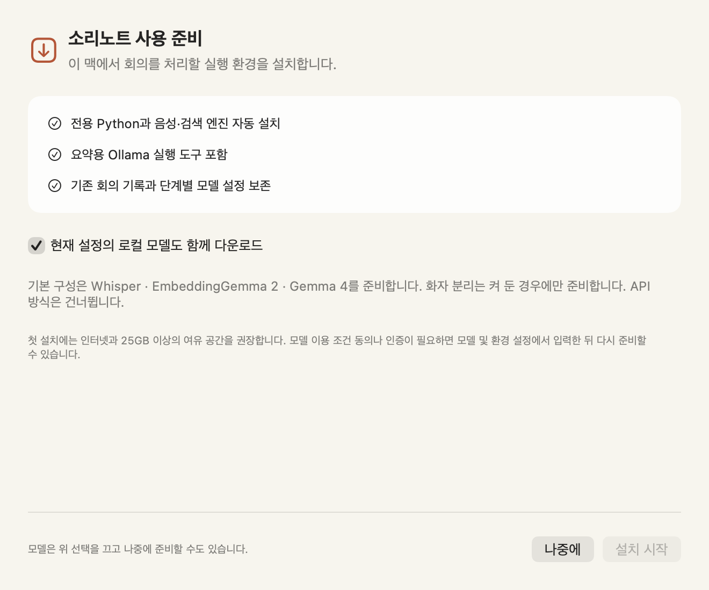
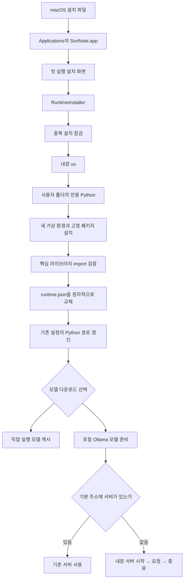

# 소리노트 자동 설치 안내

## 설치 파일로 시작하기

`SoriNote-0.5.0-arm64.pkg`는 Apple Silicon 맥에 소리노트를 설치하는 macOS 설치 파일입니다. macOS 14 이상, 기본 모델 조합에는 통합 메모리 32GB 이상을 권장합니다. 실행 환경과 모델을 준비할 때 인터넷과 25GB 이상의 디스크 여유를 확보하세요. 큰 사용자 지정 모델이나 긴 녹음을 보관하면 공간이 더 필요합니다.

1. `.pkg`를 열고 macOS 설치 안내를 따릅니다. `/Applications/SoriNote.app`에 설치되며 응용 프로그램 폴더에 쓸 관리자 인증이 요청될 수 있습니다.
2. 응용 프로그램에서 **SoriNote**를 엽니다.
3. **소리노트 사용 준비 → 설치 시작**을 누릅니다. 전용 Python 3.12.15와 음성·검색 패키지를 사용자 폴더에 설치합니다.
4. **현재 설정의 로컬 모델도 함께 다운로드**를 켜 두면 현재 선택한 모델도 준비합니다. 처음에는 Whisper, EmbeddingGemma 2, Gemma 4를 준비합니다. 요약과 질문 답변이 같은 모델이면 한 번만 받습니다.
5. **사용 시작**을 누르고 음성 설정에서 녹음 소스를 선택합니다. 실제 녹음을 시작할 때 마이크와 시스템 오디오에 대한 macOS 권한을 허용합니다.

받는 맥에는 Xcode, Homebrew, Python이나 Ollama를 미리 설치할 필요가 없습니다. 모델이 준비된 뒤 기본 로컬 처리는 인터넷 없이 사용할 수 있습니다. 완전한 오프라인 설치 파일은 아니며, Python·패키지·모델은 첫 실행 때 내려받습니다.



기존 앱 사용자는 저장된 Python 경로가 유효하면 자동 설치 화면을 생략합니다. **모델 및 환경 설정 → 공통 환경 → 자동 설치 / 복구…**에서 언제든 실행할 수 있습니다. 이 작업은 Python 경로만 준비된 새 환경으로 바꾸며 단계별 모델, 서버 주소, 음성 설정, 기록과 키체인의 키를 유지합니다.

## 모델을 나중에 준비하기

설치 화면에서 모델 다운로드 선택을 끄면 실행 환경만 설치합니다. 이후 **모델 및 환경 설정**에서 단계별 **모델 다운로드 / 준비**를 누르거나, 자동 설치 화면을 다시 열어 모델 다운로드를 선택하세요.

- 직접 실행하는 음성·임베딩 모델은 Hugging Face에서 받습니다. 로컬 모델 폴더를 지정했다면 해당 폴더를 그대로 확인합니다.
- Ollama 모델은 선택한 맥 안의 Ollama 서버로 다운로드합니다. 원격 Ollama에 설치 요청을 보내지 않습니다.
- OpenAI 호환 API를 선택한 단계는 자동 모델 다운로드에서 건너뜁니다. 사용자가 서버에 해당 모델을 준비해야 합니다.
- 화자 분리는 기능을 켠 경우만 준비합니다. Community-1 이용 조건 동의와 읽기 토큰이 필요한 경우 **공통 환경**에서 토큰을 먼저 입력하세요. 앱이 이용 조건에 대신 동의하거나 토큰을 발급하지는 않습니다.

모델 다운로드가 실패해도 설치를 끝낸 실행 환경은 유지합니다. 설정을 고친 뒤 해당 단계만 다시 준비할 수 있습니다. 취소 시 이미 받은 캐시는 남을 수 있으며 재시도에 재사용합니다.

## 저장 위치와 기존 Ollama

| 위치 | 내용 |
| --- | --- |
| `/Applications/SoriNote.app` | 앱, 워커 코드, uv·Ollama 실행 도구, 고정한 패키지 목록과 라이선스 |
| `~/Library/Application Support/SoriNote/runtime/python` | 소리노트 전용 Python |
| `~/Library/Application Support/SoriNote/runtime/engines` | 검증을 통과한 현재·이전 실행 환경 |
| `~/Library/Application Support/SoriNote/runtime/runtime.json` | 현재 실행 환경의 위치와 의존성 목록 해시 |
| `~/Library/Application Support/SoriNote/runtime/cache` | Python 패키지 다운로드 캐시 |
| `~/.cache/huggingface` | Hugging Face 기본 모델 캐시. 기존 환경 변수로 위치를 지정했다면 그 위치 사용 |
| `~/.ollama/models` | 내장 Ollama의 기본 모델 캐시 |

이미 기본 주소 `http://127.0.0.1:11434`에서 Ollama가 실행 중이면 그 서버를 그대로 사용합니다. 없으면 앱에 포함된 Ollama를 필요한 API 호출 동안만 실행하고, 앱이 직접 시작한 서버만 종료합니다. 내장 서버는 루프백 주소에만 연결하고 Ollama 클라우드 기능을 끕니다. 로그인 항목이나 상시 실행 서비스를 설치하지 않습니다.

다른 포트·주소의 서버는 자동으로 실행하지 않습니다. 별도로 실행한 Ollama의 모델 폴더·동작 설정은 해당 서버 설정을 따릅니다. 강제 종료·전원 중단으로 서버가 남은 경우 다음 실행은 이미 켜진 서버로 인식하며, 정상 취소·종료 경로에서는 직접 실행한 프로세스를 정리합니다.

기록·녹음·설정은 기존 `~/Library/Application Support/SoriNote` 아래에 유지합니다. 앱을 덮어 설치하거나 실행 환경을 복구해도 삭제하지 않습니다. 실행 환경 디렉터리는 내부에 절대 경로가 있으므로 다른 맥으로 복사하지 말고 그 맥에서 자동 설치하세요.

## 실패했을 때

| 증상 | 해결 방법 |
| --- | --- |
| 다운로드나 패키지 설치 실패 | 인터넷, 방화벽, 여유 공간을 확인하고 자동 설치를 다시 실행합니다. 완료 전의 새 환경은 정리하고 기존 환경은 유지합니다. |
| 모델 접근 승인 필요 | 모델 페이지에서 이용 조건을 확인하고, 공통 환경에 해당 계정의 읽기 토큰을 저장한 뒤 모델 준비를 다시 실행합니다. |
| 내장 Ollama 시작 실패 | 기본 11434 포트를 다른 프로그램이 사용하는지 확인합니다. 사용자 지정 서버는 설정한 주소에서 직접 실행해야 합니다. |
| 프로젝트를 옮긴 뒤 Python 경로 오류 | 설치 패키지 버전의 공통 환경에서 자동 설치 / 복구를 실행합니다. 소스 개발 환경은 `scripts/setup.sh`로 재생성할 수도 있습니다. |
| 다른 설치가 진행 중이라는 안내 | 먼저 시작한 설치를 마치거나 취소합니다. OS 파일 잠금은 프로세스 종료 시 풀리므로 잠금 파일을 직접 지울 필요가 없습니다. |
| 실행 환경은 설치됐는데 모델 다운로드만 실패 | 실행 환경은 그대로 쓸 수 있습니다. 해당 단계의 모델 이름·접근 권한을 고치고 모델만 다시 준비합니다. |

재설치는 이전 실행 환경을 자동으로 지우지 않습니다. 복구가 끝나고 새 환경이 정상 작동하는 것을 확인한 뒤 필요 없는 이전 `engines` 폴더와 패키지 캐시를 수동 정리할 수 있습니다. 현재 `runtime.json`이 가리키는 환경과 `runtime/python`은 지우지 마세요. 앱 삭제만으로 기록과 모델을 삭제하지 않습니다.

## 개발자가 설치 파일 만들기

프로젝트 루트에서 다음을 실행합니다. 빌드 맥에는 Command Line Tools가 필요합니다. 이 과정에는 Python AI 환경 설치가 필요하지 않습니다.

```bash
bash scripts/build-installer.sh
```

결과는 `dist/SoriNote-0.5.0-arm64.pkg`, 같은 이름의 `.sha256`, `dist/SoriNote.app`입니다. `dist`는 Git에서 제외되어 있습니다. 소스는 프로젝트 루트를 GitHub에 올리고, 공개 배포 시 완성한 설치 파일은 GitHub Releases의 첨부 파일로 배포하면 됩니다.

빌드 순서는 Swift Release 빌드 → 공식 uv·Ollama 파일 다운로드 → 고정 SHA-256 검증 → 앱 리소스에 포함 → 코드 서명 → `.pkg` 생성입니다. 도구 버전과 검증 해시는 `installer/versions.sh`, Python 패키지는 `worker/requirements.lock.txt`에 고정합니다. `installer/licenses`에는 uv와 Ollama의 라이선스가 있으며, Ollama 압축 파일에 포함된 하위 구성 요소의 고지도 함께 배포합니다. 모델 가중치는 설치 파일에 포함하지 않습니다.

빌드 도구를 갱신할 때는 공식 릴리스의 해시를 다시 확인하고 `versions.sh`와 라이선스를 갱신하세요. `.runtime/installer-tools`를 비워 과거 파일이 섞이지 않도록 한 뒤 새로 빌드합니다. Python 버전은 `RuntimeInstaller.pythonVersion`, AI 패키지는 요구사항과 잠금 파일을 갱신하고 별도 폴더에 실제 설치하여 검증하세요.

### 서명과 공증

현재 생성물은 **개발용 임시 앱 서명이며 설치 패키지는 Developer ID 서명·Apple 공증이 없습니다.** 다른 맥에서 일반 배포판처럼 경고 없이 설치된다고 보장할 수 없습니다. Gatekeeper를 끄는 방식은 설치 절차에 넣지 않았습니다.

배포용 인증서를 가진 개발자는 다음 환경 변수로 앱과 패키지에 서명할 수 있습니다. 실제 키와 인증서 파일을 저장소에 올리지 마세요.

```bash
CODE_SIGN_IDENTITY='Developer ID Application: 본인의 이름 (팀 ID)' \
INSTALLER_SIGN_IDENTITY='Developer ID Installer: 본인의 이름 (팀 ID)' \
bash scripts/build-installer.sh
```

이후 Apple 공증 제출·성공 확인·티켓 부착과 새 맥에서의 Gatekeeper 검사를 별도로 수행합니다. 인증서 없는 현재 빌드에서는 이 과정을 검증하지 않았습니다. 내려받는 Python과 패키지의 실행, 포함된 추론 라이브러리의 Hardened Runtime 호환성도 실제 배포 서명 환경에서 확인해야 합니다. 로컬 임시 서명 검증과 Apple 공증은 다른 단계입니다.

## 자동 설치 구조와 동작 원리



실행 환경은 완성된 위치에서 설치합니다. 가상 환경의 실행 스크립트에 절대 경로가 들어가기 때문에 임시 위치에 만든 환경을 나중에 옮기지 않습니다. 핵심 import 검사를 통과해야 현재 환경을 가리키는 파일을 교체합니다. 실패·취소하면 새 환경만 정리하고, 이전에 완료된 환경은 유지합니다. 이 방식은 기존 환경을 덮어쓰다 실패해서 앱 전체가 실행되지 않는 상황을 줄입니다.

설치 패키지에는 관리자 권한으로 Python·모델을 받는 사후 스크립트가 없습니다. 시스템 영역에는 앱만 설치하고, 실제 실행 환경은 로그인한 사용자의 권한으로 만듭니다. 패키지 목록의 해시가 같고 import 검사도 통과하면 기존 환경을 재사용합니다. 모델 준비는 그 다음 독립 단계여서 일부 모델이 실패해도 설치가 끝난 Python 환경을 다시 받을 필요가 없습니다.

검증 내용과 남은 실기 확인 항목은 [검증 기록](VERIFICATION.md)을 참고하세요.
