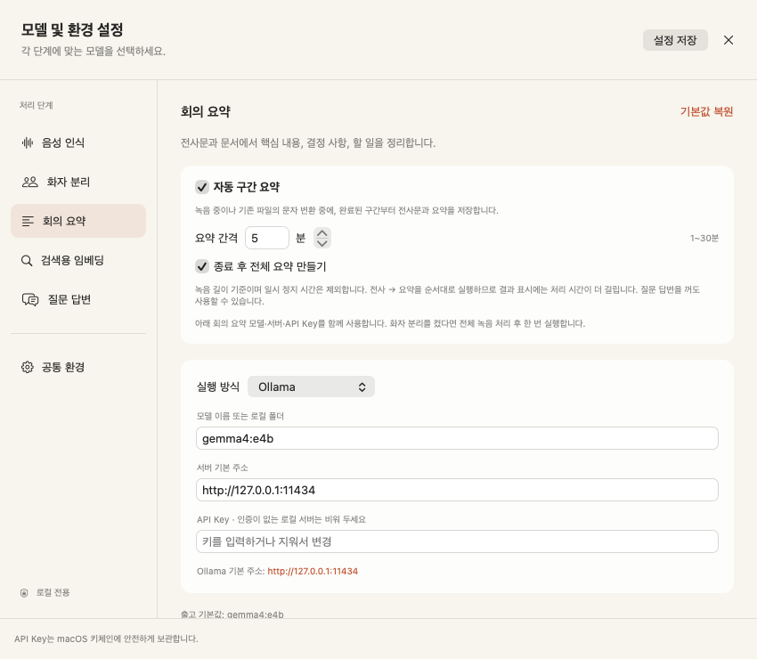
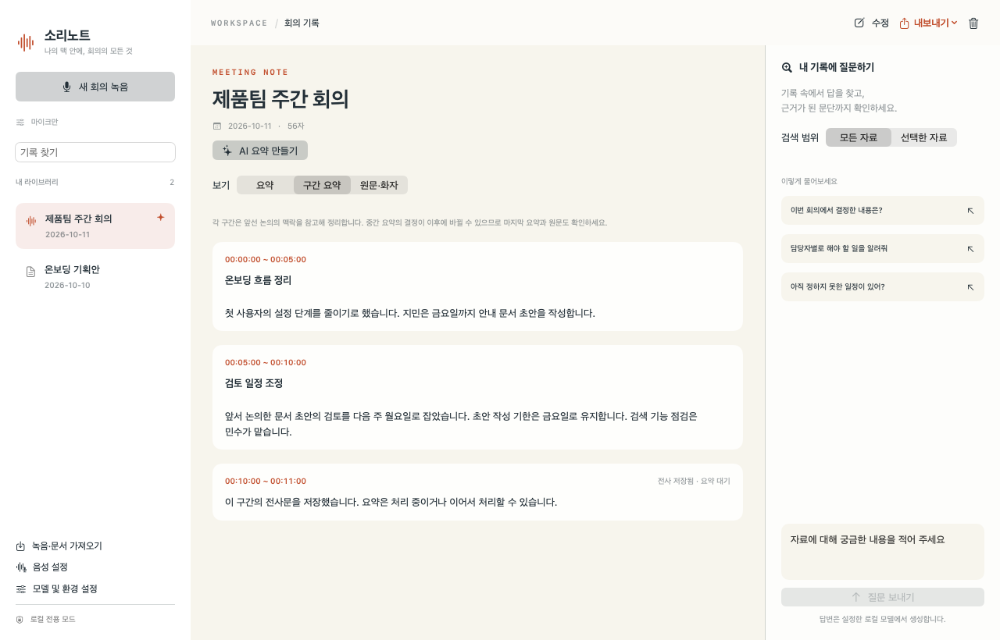
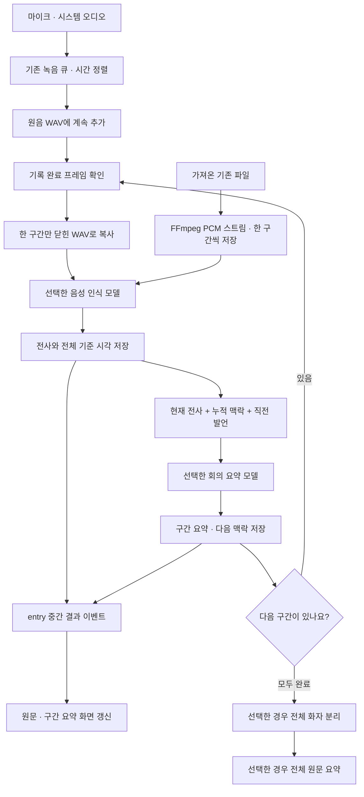

# 자동 구간 요약 사용법과 동작 원리

0.7.0부터 녹음 중이거나 기존 녹음 파일을 문자로 바꾸는 동안, 설정한 분량마다 전사문과 요약을 저장합니다. 처음에는 **꺼짐**, 간격은 **5분**, **종료 후 전체 요약 만들기**는 켜짐입니다. 기존 사용자의 설정이나 기록을 임의로 바꾸지 않습니다.

## 켜고 사용하기

1. **모델 및 환경 설정 → 회의 요약**을 엽니다.
2. **자동 구간 요약**을 켭니다.
3. **요약 간격**을 입력하거나 옆 조절 버튼으로 바꿉니다. 로컬 음성 인식은 1~30분, OpenAI 호환 음성 API는 파일당 25MB 제한 때문에 1~13분입니다. 우선 5분으로 시작해 처리 속도를 확인하세요.
4. 필요하면 **종료 후 전체 요약 만들기**를 켜고 **설정 저장**을 누릅니다.
5. 새 회의를 녹음하거나, 기존 녹음을 선택해 **문자 변환**을 누릅니다. **구간 요약** 탭에 `00:00:00~00:05:00`과 같은 카드가 쌓입니다.



간격은 **녹음에 포함된 시간** 기준입니다. 일시 정지한 시간은 포함하지 않습니다. 5분으로 설정하면 첫 5분이 디스크에 기록된 뒤 전사와 요약을 시작합니다. 정확히 5분이 되는 순간 결과가 표시되는 것은 아니며, 모델을 불러오고 처리하는 시간이 더 필요합니다. 12분 녹음이라면 5분·5분·2분 순서로 처리합니다.

이미 가져온 파일은 벽시계로 5분을 기다리지 않습니다. 녹음 내용 5분씩을 순서대로 처리하며 완료한 구간부터 보여 줍니다. 설정 변경은 다음 작업부터 적용합니다. **이어서 처리**는 해당 회의를 시작할 때 저장한 간격을 사용하므로, 간격 자체를 바꾸려면 설정 저장 후 **문자 변환**을 다시 실행하세요. 다시 변환하면 기존 전사·화자 이름·요약이 바뀝니다.

## 화면에서 확인할 내용

- **구간 요약**: 시간별 논의와 결정의 흐름을 보여 줍니다. 전사는 끝났지만 요약이 아직 끝나지 않았다면 `전사 저장됨 · 요약 대기`로 표시합니다.
- **원문·화자**: 끝난 구간의 전사문이 차례로 늘어납니다. 최종 녹음 저장 후 발언 시각을 눌러 원음을 확인할 수 있습니다.
- **요약**: 전체 요약 옵션을 켰다면 모든 구간을 처리한 뒤 전체 원문으로 작성합니다. 옵션을 꺼도 나중에 **AI 요약 만들기**를 눌러 만들 수 있습니다.



녹음 중에는 **일시 정지 / 이어 녹음**, **녹음 완료**를 계속 사용할 수 있습니다. AI가 처리 중이어도 녹음 중지는 별도로 실행됩니다. 녹음을 완료하면 남은 구간과 선택한 후처리를 마칠 때까지 진행 상태가 표시됩니다. 단어가 말해지는 즉시 나타나는 실시간 자막 기능은 아닙니다.

## 문맥을 어떻게 반영하나요?

이번 구간의 전사문과 함께, **앞선 논의의 누적 맥락**과 **직전 구간의 끝부분**을 요약 모델에 전달합니다. 예를 들어 앞에서 “온보딩 문서를 작성한다”고 말하고 이번 구간에서 “그 검토는 월요일에 하자”고 했다면, 이전 내용을 참고해 검토 대상을 이해하도록 합니다.

이전 자료는 참고용, 이번 전사문은 요약 대상이라고 분명히 구분합니다. 이전 결정을 이번에 새로 내린 것처럼 반복하거나, 담당자·날짜를 추측하지 않도록 지시합니다. 구간 요약 후에는 다음 구간에서 사용할 맥락을 갱신합니다. 누적 맥락은 최대 4,000자, 직전 발언은 최대 1,500자만 전달해 회의가 길어져도 입력이 계속 늘어나지 않게 했습니다.

맥락 압축 과정에서 오래된 세부 사항이 빠질 수 있고, 모델이 지시를 항상 정확하게 따르는 것은 아닙니다. 앞 구간의 결정이 뒤에서 바뀌어도 이전 카드를 소급해서 고치지는 않습니다. 구간 카드는 당시의 기록이며 최종 결정은 전체 요약과 원문에서 확인하세요. 시간 경계에서 문장이 끊길 수 있으며, 현재는 침묵이나 문장 끝을 찾아 구간 경계를 이동하지 않습니다.

## 메모리와 모델 선택

새 모델은 추가하지 않습니다. 기존 **음성 인식**과 **회의 요약** 설정을 그대로 사용합니다. 회의 요약의 모델·서버 주소·API Key를 바꾸면 구간 요약에도 적용합니다. 요약은 Ollama 또는 OpenAI 호환 `/chat/completions`를 사용합니다. 외부 서버를 고른 경우 기존 외부 전송 허용 정책이 동일하게 적용됩니다.

처리는 **한 구간 전사 → 전사 모델 캐시 해제 → 해당 구간 요약 → 다음 구간** 순서입니다. 녹음은 별도로 계속하고, 밀린 음성은 메모리 대기열 대신 원음 파일에 남깁니다. 질문 답변과 임베딩은 구간 요약에 필요하지 않으므로 꺼 두어도 됩니다.

기본 Whisper의 약 4~6GB, Gemma 요약의 약 8~12GB라는 기존 계획용 메모리 예산은 계속 고려해야 합니다. 간격을 줄인다고 모델 자체가 작아지는 것은 아닙니다. 짧은 간격은 결과를 자주 얻는 대신 모델 재로딩과 맥락 갱신을 더 자주 수행합니다. Ollama 요청은 기존과 같이 `keep_alive: 0`을 사용하지만, 사용자 지정 OpenAI 호환 서버의 상주 메모리는 해당 서버가 관리합니다. 실제 최대 메모리를 새로 측정한 수치는 아닙니다.

**화자 분리**를 켰다면 모든 구간의 전사가 끝난 뒤 전체 원음으로 한 번 실행합니다. 구간마다 독립적으로 실행하면 서로 다른 사람을 모두 “화자 1”로 부를 수 있기 때문입니다. 처리 중에는 화자가 미지정으로 표시되며, 구간 요약에도 실제 사람 이름을 자동으로 붙이지 않습니다. 음성 API가 발언별 시각을 제공하지 않으면 후속 화자 분리를 생략하고 안내합니다.

## 중지·오류·다시 실행

녹음 중 **자동 요약 중지**는 AI 처리만 중지합니다. 녹음은 계속 저장하며, **녹음 완료** 후 **구간 처리 이어하기**로 남은 전사와 요약을 처리할 수 있습니다. 요약 오류가 나면 반복 요청하지 않고 자동 처리를 멈춰 안내합니다.

요약 전에 전사문을 먼저 DB에 저장합니다. 요약만 실패한 구간을 이어서 처리할 때는 저장된 전사문을 재사용합니다. 이미 끝난 구간을 다시 붙이지 않으며, 모든 구간이 끝난 뒤 전체 요약에서 실패해도 구간별 기록은 남습니다. 일반 파일 처리의 **취소** 역시 완료한 구간을 보존합니다.

앱이 비정상 종료되면 원음 초안과 회의 ID의 연결 파일을 통해 다음 실행에서 같은 기록에 녹음을 복구합니다. 디스크에 저장되기 전에 유실된 오디오까지 복원하지는 못합니다. 원음 복구 후 **구간 처리 이어하기**로 재개하세요.

**제목만 수정**하면 구간 요약은 유지됩니다. **본문이나 화자 이름을 수정**하면 근거가 달라지므로 기존 전체·구간 요약과 검색 색인을 비웁니다. 미리 보관할 내용은 내보내세요. **요약 포함 Markdown 저장**과 **녹음 + 전사문 함께 저장**의 `회의록.md`에는 시간별 구간 요약도 포함됩니다. `전사문.txt`에는 AI 요약을 섞지 않습니다.

## 개발자를 위한 구조



파일 처리에서는 다음 구간도 FFmpeg 스트림에서 꺼냅니다. 위 그림의 `CUR` 반복은 녹음 중 경로를 나타냅니다.

| 구성 요소 | 책임 |
| --- | --- |
| `RecordingIntervalCursor` | 처리한 프레임 위치 보관, 밀린 구간 순서 유지, 마지막 짧은 구간 반환 |
| `PCMRecordingWriter.copyRange` | 이미 쓴 PCM만 64KiB씩 복사, 올바른 WAV 헤더 생성, 원음 변경 없음 |
| `AppStore.runIntervalRecording` | 한 번에 워커 하나 실행, 녹음 제어 분리, 중지 후 원음 연결, 복구 연결 파일 관리 |
| `worker/sorinote/intervals.py` | 파일 분할, 전사·문맥 요약·최종 처리, 완료 구간 재사용 |
| `Store.save_interval` / `finish_interval` | 전사와 요약의 별도 커밋, 누락·중복 없는 구간 저장 |
| `WorkerClient`의 `entry` 이벤트 | 요청이 끝나기 전에 저장된 전사와 요약을 화면에 전달 |

설정은 `intervalSummaryEnabled: false`, `intervalMinutes: 5`, `intervalFinalSummary: true`로 이전 설정에 기본값을 보충합니다. SQLite는 스키마 2로 이전하면서 `entries.interval_seconds`, `entries.interval_complete`와 `interval_notes`를 추가합니다. 구간 테이블은 `(entry_id, ordinal)`을 키로 쓰고 전사·시각·요약·누적 맥락·상태를 저장합니다. 상태는 `transcribed` 또는 `complete`입니다. 기존 기록은 삭제하지 않습니다.

워커의 `interval`은 닫힌 구간 파일·시작/끝 시각·회의 ID를 받아 한 구간을 처리합니다. `continueIntervals`는 저장된 간격과 마지막 상태로 남은 부분을 처리합니다. `finalizeIntervals`는 화자 분리와 전체 요약을 선택적으로 수행합니다. `attachAudio`는 녹음 중 생성한 기록에 완성된 원음을 연결하며 전사·구간 요약을 유지합니다. 기능을 켠 `transcribe`는 기존 파일을 구간별로 처리하고, 기능을 끄면 기존 일괄 전사 경로를 사용합니다.

기본 MLX의 단어 시각도 전체 회의 기준으로 옮겨 DB에 남기므로, 마지막 화자 분리에서 단어 기준 정렬을 재사용할 수 있습니다. API가 구간 시각 없이 본문만 주면 구간 전체의 시간 범위만 표시하고 발언별 시각은 만들지 않습니다. 마지막 0.1초 미만의 꼬리는 인식기에 보내지 않고 발언 없음으로 기록합니다.

녹음 콜백에서 모델을 호출하지 마세요. 녹음 큐의 `writtenFrames`까지만 읽고, 원음의 이미 기록된 PCM 본문이 바뀌지 않는 조건을 지켜야 합니다. 파일 분할 생성기는 예외·취소 시 닫아서 FFmpeg와 임시 사본을 정리합니다. 새 구간 전사가 성공하기 전에는 기존 기록을 지우지 않습니다. 수동 편집은 요약을 무효화하지만 정상적인 구간 추가와 마지막 화자 정렬은 구간 요약을 별도로 유지합니다.

## 검사 방법

```bash
# 모델과 실제 녹음을 사용하지 않는 기본 검사
bash scripts/test.sh

# 합성 WAV, 실제 FFmpeg, 로컬 모의 OpenAI 호환 서버 연결 검사
.venv/bin/python scripts/smoke-intervals.py

# 이미 준비된 Whisper·Gemma 모델의 실제 추론 검사: 새 다운로드 없이 실행
# Ollama가 실행 중이 아니라면 내장 실행 파일을 지정합니다.
SORINOTE_OLLAMA_BIN="$PWD/.runtime/installer-tools/ollama/ollama" \
  .venv/bin/python scripts/smoke-interval-models.py
```

실제 검증 범위와 남은 제한은 [검증 기록](VERIFICATION.md)에 적습니다. 실제 Teams 장시간 녹음, 저메모리 맥의 최대 사용량과 다양한 회의 정확도는 합성 음성 검사로 보장할 수 없습니다.
