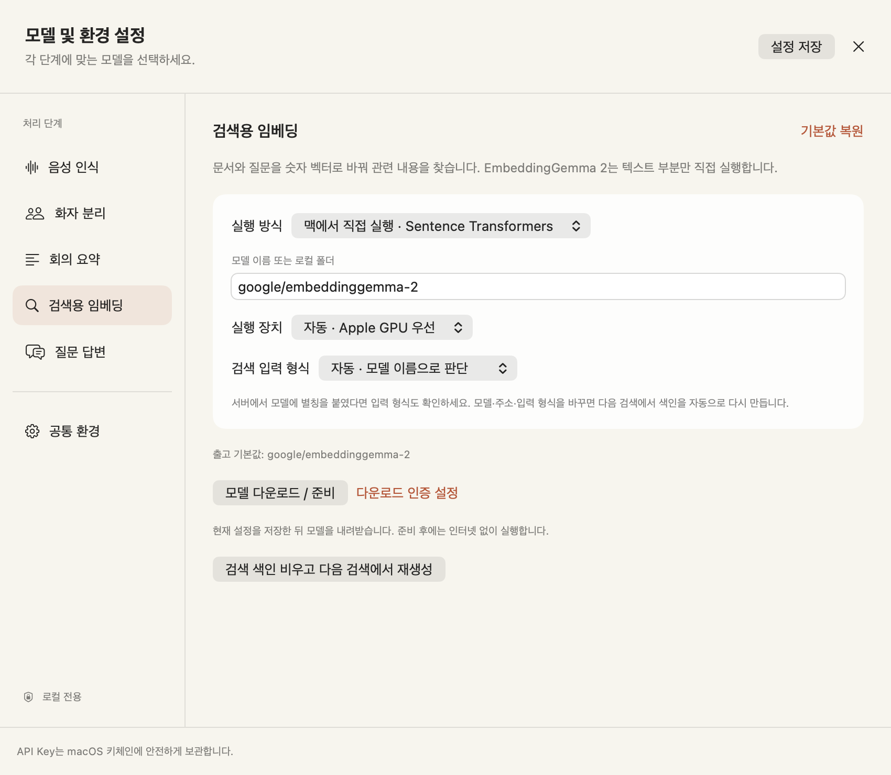
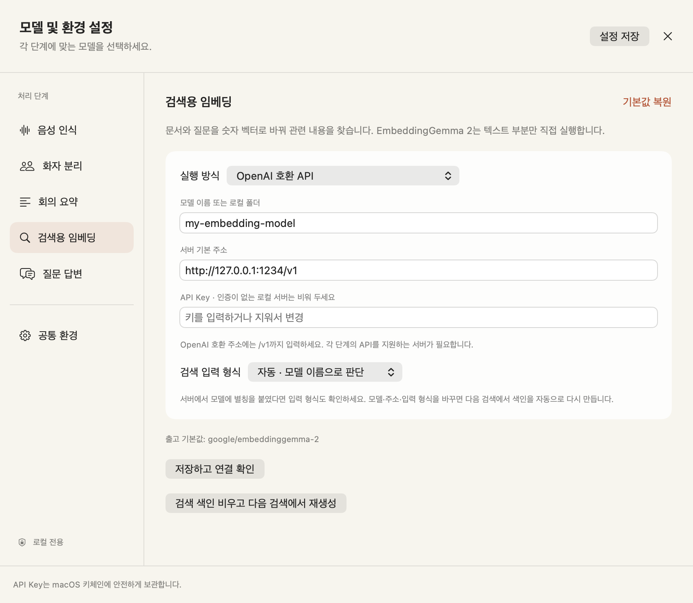

# 모델 선택과 API 설정

소리노트는 음성 인식, 화자 분리, 요약, 검색용 임베딩, 질문 답변을 따로 설정합니다. **모델 및 환경 설정**에서 왼쪽의 단계를 선택하면 그 단계에 필요한 항목만 나옵니다. 어떤 단계든 **OpenAI 호환 API**로 바꿀 수 있습니다. 단, 서버가 그 단계의 API를 실제로 제공해야 합니다.



## 출고 기본값과 내가 저장한 기본값

| 단계 | 출고 기본 모델 | 실행 방식 | 바꿀 수 있는 방식 |
| --- | --- | --- | --- |
| 음성 인식 | `mlx-community/whisper-large-v3-turbo` | MLX 직접 실행 | MLX / OpenAI 호환 음성 API |
| 화자 분리 | `pyannote/speaker-diarization-community-1` | pyannote CPU 직접 실행, 기능은 꺼짐 | pyannote / OpenAI 호환 화자 전사 API |
| 회의 요약 | `gemma4:e4b` | Ollama | Ollama / OpenAI 호환 Chat API |
| 검색용 임베딩 | `google/embeddinggemma-2` | Sentence Transformers 직접 실행 | 직접 실행 / Ollama / OpenAI 호환 Embeddings API |
| 질문 답변 | `gemma4:e4b` | Ollama | Ollama / OpenAI 호환 Chat API |

**설정 저장**을 누르면 선택한 값이 다음 작업과 다음 앱 실행의 기본값이 됩니다. **기본값 복원**은 현재 선택한 단계만 위 표의 값으로 되돌리며, 저장 전에는 실제 작업에 반영하지 않습니다. API Key는 기본값 복원으로 삭제되지 않습니다.

이전 버전의 설정은 자동으로 읽습니다. 검색용 임베딩이 예전 출고값인 `embeddinggemma:300m`과 기본 Ollama 주소 그대로일 때만 EmbeddingGemma 2로 이전합니다. 사용자가 따로 지정한 모델과 서버는 보존합니다. 새 버전에서 예전 모델을 직접 선택해 저장한 경우에는 다음 실행 때 다시 바꾸지 않습니다.

## EmbeddingGemma 2 직접 실행

모델 이름만 바꾸는 연동이 아닙니다. `local_embedding.py`가 Sentence Transformers와 Transformers를 통해 실제 모델을 불러오고, 문서와 질문의 검색 벡터를 생성합니다. Ollama의 지원 여부와 무관하게 실행할 수 있습니다.

1. 프로젝트의 `scripts/setup.sh`로 새 의존성을 설치하고 앱을 다시 빌드합니다.
2. **검색용 임베딩**에서 실행 방식을 **맥에서 직접 실행 · Sentence Transformers**로 선택합니다.
3. 모델 이름을 `google/embeddinggemma-2`, 장치를 **자동 · Apple GPU 우선**으로 둡니다.
4. **모델 다운로드 / 준비**를 누릅니다. 현재 설정을 저장한 뒤 모델을 받습니다.
5. 문서를 가져오거나 전사를 완료한 뒤 질문합니다. 처음 검색할 때 색인을 만듭니다.

EmbeddingGemma 2는 텍스트·이미지·음성 인코더를 가진 모델이지만, 이 앱의 문서 검색은 **텍스트 부분만 로드**합니다. 검색 벡터는 768차원이며 정규화합니다. 이미지·음성 자체를 멀티모달 검색하는 기능을 추가한 것은 아닙니다. float16은 사용하지 않고 float32로 실행합니다. [Google 공식 모델 카드](https://huggingface.co/google/embeddinggemma-2), [Transformers 모델 문서](https://huggingface.co/docs/transformers/en/model_doc/embedding_gemma2)

자동 설정은 Apple GPU(MPS)를 먼저 선택합니다. 지원되지 않는 MPS 연산으로 실패하면 CPU에서 재시도합니다. 사용자가 Apple GPU를 명시한 경우에는 임의로 장치를 바꾸지 않습니다. 이 맥의 M5 Max·36GB에서 MPS 실행과 한국어 검색을 확인했습니다. 구체적인 범위는 [검증 기록](VERIFICATION.md)에 있습니다.

모델 파일은 준비 단계에서만 다운로드합니다. 평소 검색은 캐시된 파일을 사용하며 `HF_HUB_OFFLINE=1`을 설정합니다. API Key는 필요하지 않습니다. 접근 제한이 있는 다른 모델을 선택한다면 **공통 환경**의 Hugging Face 읽기 토큰과 해당 모델의 이용 조건을 확인하세요.

## 검색 입력 형식과 색인 갱신

임베딩은 같은 문장도 모델과 입력 형식에 따라 다른 벡터를 만듭니다. 설정에는 다음 선택지가 있습니다.

- **자동**: 모델 이름에 `embeddinggemma`가 있으면 검색용 접두어를 붙입니다.
- **EmbeddingGemma 형식**: 서버에서 다른 별칭으로 서비스하더라도 접두어를 붙입니다.
- **접두사 없음 · 서버에서 처리**: 다른 모델을 사용하거나 서버가 이미 접두어를 넣는 경우 선택합니다.

```text
질문: task: search result | query: 초안은 언제까지인가요?
문서: title: 제품팀 회의 | text: 금요일까지 초안을 완성합니다.
```

직접 실행에서는 라이브러리의 기본 접두어를 끄고 앱에서 한 번만 붙입니다. 서버 방식에서는 서버의 설정도 확인해야 합니다. 두 곳에서 접두어를 붙이면 품질이 떨어질 수 있습니다.

모델·실행 방식·주소·입력 형식·문서가 바뀌면 **다음 질문에서 검색 대상 자료의 색인을 자동으로 재생성**합니다. 새 벡터가 완성되기 전에는 이전 색인을 지우지 않습니다. 같은 이름으로 서버의 가중치만 교체했다면 앱이 알 수 없으므로 **검색 색인 비우고 다음 검색에서 재생성**을 누르세요. 이 버튼은 기존 색인을 비우며 실제 재생성은 다음 질문에서 합니다. 원문과 요약은 유지됩니다.

## 모든 단계에서 OpenAI 호환 API 사용하기



각 단계에서 다음 값을 입력하고 **설정 저장**을 누릅니다.

```text
실행 방식: OpenAI 호환 API
모델: 서버에 실제로 설치하거나 배포한 모델 ID
서버 기본 주소: http://127.0.0.1:1234/v1
API Key: 서버가 요구하는 키, 인증이 없는 로컬 서버는 비워 둠
```

예시 주소는 형식을 보여 주기 위한 것입니다. 이 주소의 서버가 다섯 기능을 모두 제공한다는 뜻은 아닙니다. 각 단계에 다른 주소와 키를 지정할 수 있습니다. **실행 방식을 처음 바꾸면 모델 칸은 비워집니다.** 서버마다 이름이 다르므로 직접 입력해야 합니다. 설정창을 닫기 전 같은 방식으로 돌아가면 그 창에서 입력하던 값을 복원합니다.

| 단계 | 요청 경로 | 서버가 지원해야 하는 응답 |
| --- | --- | --- |
| 음성 인식 | `POST /audio/transcriptions` | `verbose_json`의 `segments[].start/end/text`, 또는 `json`의 `text` |
| 화자 분리 | `POST /audio/transcriptions` | `diarized_json`의 `segments[].start/end/speaker`, `chunking_strategy=auto` 지원 |
| 요약·질문 답변 | `POST /chat/completions` | `choices[0].message.content` |
| 검색용 임베딩 | `POST /embeddings` | `data[].index/embedding` |

앱이 기본 주소 뒤에 표의 경로를 붙입니다. `/v1`이 필요한 서버는 기본 주소에 포함하고, `/chat/completions`까지 넣지는 마세요. 인증은 `Authorization: Bearer …` 형식입니다. 연결 점검은 `/models` 접근까지만 확인하므로 해당 모델의 실제 음성·임베딩 지원을 보장하지 않습니다.

### 음성 인식과 화자 API의 차이

OpenAI 호환이라는 표현만으로 음성·화자 API까지 지원한다고 볼 수 없습니다. 일반 채팅 서버에 화자 모델 이름만 넣으면 동작하지 않습니다. [OpenAI 공식 음성 전사 규격](https://developers.openai.com/api/docs/guides/speech-to-text)을 지원하는 서버가 필요합니다.

음성 인식 API에는 파일을 multipart로 전송합니다. `whisper-1`처럼 시각 정보를 반환하는 모델은 **verbose_json**으로 사용합니다. `json`만 지원하는 모델에서는 본문만 받을 수 있습니다. 이 경우 전사·요약·검색은 가능하지만 시각 이동과 후속 화자 분리는 사용할 수 없습니다. 앱은 가짜 시각을 만들지 않습니다.

화자 API는 `gpt-4o-transcribe-diarize`처럼 `diarized_json`과 자동 청크 처리를 지원하는 모델을 대상으로 합니다. 반환된 화자 구간을 앞 단계의 전사문과 정렬하며, 화자 API가 만든 새 본문으로 기존 전사문을 덮어쓰지 않습니다. 화자 API의 인원 수는 서버가 판단합니다. 앞 단계도 API라면 같은 파일이 두 단계의 서버에 각각 전송될 수 있습니다.

앱은 음성 API 업로드를 파일당 **25MB 이하**로 제한합니다. 긴 파일은 나누거나 MLX 직접 실행을 사용하세요. API로 보내는 파일명은 원본 이름 대신 `recording`으로 바꿉니다. 파일 내용과 내부 메타데이터까지 익명화하는 기능은 아닙니다.

### 외부 서버와 API Key

로컬 전용이 기본입니다. 외부 API를 쓰려면 **공통 환경 → 외부 서버로 음성·텍스트 전송 허용**을 켜고 HTTPS 주소를 사용합니다. 선택한 단계에 따라 녹음 파일, 원문, 질문과 근거 문단이 전송됩니다. 이 설정은 새 데이터 처리 범위를 결정하므로 서버 운영 주체를 확인하세요.

키는 단계별로 macOS 키체인에 보관합니다. 입력칸에서 수정하고 저장하면 갱신되며, 비우고 저장하면 삭제됩니다. 평문 설정·Git·명령줄 인자에는 쓰지 않습니다. 재빌드로 임시 서명이 바뀌면 macOS가 키체인 접근을 다시 물을 수 있습니다.

## 기존 모델을 계속 쓰기

요약과 질문 답변은 기존처럼 Ollama의 `gemma4:e4b`를 사용합니다. Ollama 기본 주소는 `http://127.0.0.1:11434`이며 `/api`를 붙이지 않습니다. `ollama pull gemma4:e4b`로 모델을 준비하고 서버를 실행하세요.

검색용 임베딩을 이전 방식으로 바꾸려면 **Ollama**, 모델 `embeddinggemma:300m`, 주소 `http://127.0.0.1:11434`를 입력합니다. 이 모델은 EmbeddingGemma 2와 다른 모델입니다. 별도로 내려받아야 하며 변경 후 색인도 재생성됩니다.

음성 인식은 MLX Whisper 호환 저장소·로컬 폴더를 선택합니다. 화자 분리는 pyannote 4와 배타적 화자 구간 출력이 호환되는 파이프라인을 선택합니다. Community-1은 이용 조건 동의와 읽기 토큰이 필요할 수 있습니다. 화자 번호는 회의 안에서만 유효하고 실제 이름은 사용자가 붙입니다. [MLX Whisper](https://github.com/ml-explore/mlx-examples/tree/main/whisper), [Community-1](https://huggingface.co/pyannote/speaker-diarization-community-1)
